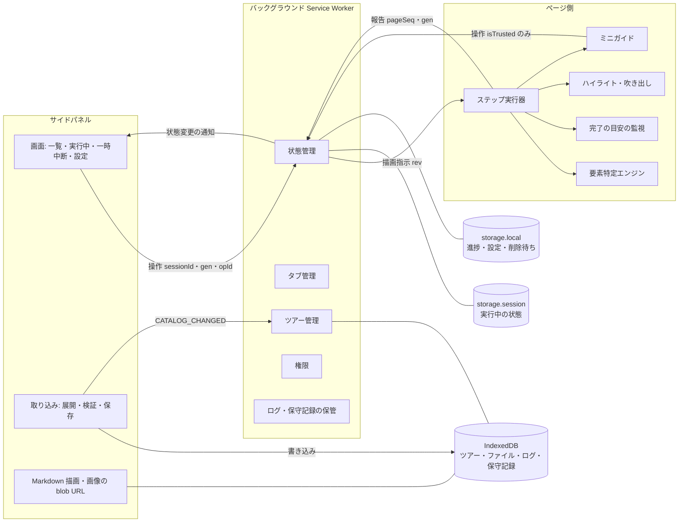

# Guided Setup Tour 設計書

## 目的

`docs/requirements.md`（要件仕様書）に定めた外部の振る舞いを実現するための、内部構造と実装方式を定めます。
読み手は、拡張機能の開発者とツアー形式の保守者です。
要件仕様書の受け入れ基準（AC-01〜73）と、本書「テスト方針」のテストがすべて通ったときを完成とします。
設計の中心は、「誤って案内する危険を減らすため確信が持てなければ失敗を選び、失敗しても作業を止めない」を、要素の特定・非同期処理・データの受け入れの各所で一貫させることです。
社内ツールのため、性能の作り込みは行いません。重い処理が状態管理を止めないことだけを、構造で保証します。

## 範囲

### 対象

- 実行場所（サイドパネル・バックグラウンド・ページ側）の分担と、その間のメッセージ・検証
- 古い操作・古い結果を捨てる識別子、状態の確定と保存の順序、Service Worker 再起動時の復帰
- ツアー形式（schemaVersion 3）、構造化した URL 条件、ツアーパッケージの取り込み（サイドパネル側）と保存
- 要素特定エンジン（探索・必須の照合・補助の照合・再検証）、探索と監視のライフサイクル
- ページ上の表示（ハイライト・吹き出し・ミニガイド・表示を戻すボタン）
- 状態管理、タブ管理、権限、ツアー管理、ロガー、保守記録
- 実装の最初に行う技術検証

### 対象外

- 資料作成モード：別の仕様書で扱う。撮影関連のコードと `<all_urls>` 権限は持たない
- 要件仕様書で対象外とした機能（自動進行、自動でページを開く、HTML・SVG の表示、iframe・Shadow DOM の中の特定、旧版を保持したままの実行、性能の数値要件など）

## 前提と制約

### 技術

| 項目 | 内容 |
|---|---|
| 基盤 | Chrome 拡張機能 Manifest V3、Chrome 114 以降 |
| 言語 | TypeScript（`strict: true`、`noUncheckedIndexedAccess`）。`any` と `as` による型の握りつぶしは避け、`unknown` と型の絞り込みを使う |
| パッケージ管理 | pnpm（corepack 経由）。`package.json` の `packageManager` と `.node-version` でバージョンを固定する。npm / npx は使わない |
| ビルド | esbuild（IIFE 形式、`target: chrome114`） |
| 主なライブラリ | zod（形式とメッセージの検証）、yaml（YAML 1.2 の解析、行番号、エイリアス数の制限）、dom-accessibility-api（読み上げ名・役割の計算）、markdown-it（Markdown の解析、`html: false`）、fflate（zip の逐次展開と作成） |
| テスト | Vitest、jsdom、Playwright |

### 実行場所ごとの制約

| 実行場所 | 使えるもの | 使わないもの |
|---|---|---|
| バックグラウンド（Service Worker） | chrome.* API、IndexedDB、storage | `URL.createObjectURL`（使えない）、YAML・zip・画像の解析（状態管理の列を塞がないため） |
| サイドパネル（拡張機能のページ） | IndexedDB（バックグラウンドと同じオリジンなので共有できる）、`URL.createObjectURL`、fflate、yaml、markdown-it、権限の要求 | - |
| ページ側（コンテンツスクリプト） | DOM、chrome.runtime のメッセージ | 拡張機能の IndexedDB（ページのオリジンになるため使えない）、画像の表示 |

### 権限・manifest

| 項目 | 値 | 理由 |
|---|---|---|
| permissions | `storage`、`unlimitedStorage`、`scripting`、`tabs`、`webNavigation`、`sidePanel` | タブ URL の判定、ページへの組み込み、遷移の検知、サイドパネル |
| optional_host_permissions | `https://*/*`、`http://*/*` | ツアーの `origins` だけを実行時に要求する |
| commands | `_execute_action`（推奨キー：`Alt+Shift+G`） | ショートカットキーでサイドパネルを開く（FR-46）。`openPanelOnActionClick: true` と組み合わせる |
| key | 固定した公開鍵 | 導入場所によらず拡張機能 ID を固定する（FR-117）。秘密鍵は配布物にもリポジトリにも含めない |
| CSP (extension_pages) | `script-src 'self'; object-src 'none'; img-src 'self' data: blob:; frame-src 'none'` | 外部画像を禁止する。取り込んだ画像はサイドパネルで blob URL にして表示する |

### 上限値

| 対象 | 上限 |
|---|---|
| zip ファイル（圧縮時） | 20 MB |
| 展開後の合計（実際に展開したバイト数で数える） | 50 MB |
| パッケージ内のファイル数 | 500 |
| 取り込み済みツアーの合計容量 | 200 MB |
| 画像1枚 | 5 MB、4096×4096 px 以内、かつ 1,600 万画素以内 |
| `tour.yaml` | 1 MB |
| Markdown ファイル1つ | 200 KB |
| YAML のエイリアス展開数 | 100 |
| YAML の入れ子の深さ | 32 |
| ステップ数 | 200 |
| 1つのステップの手がかりの候補数 | 各20 |
| URL 条件のパス | 200文字、32区間、`**` は4個まで |
| 照合する URL の区間数 | 256（超えたら一致しないとみなす） |
| ログ | 2,000件・30日（どちらか先に達した方で削除） |
| 保守記録 | 1,000件（最終日時の古いものから削除） |
| 処理済みの操作 ID の記憶 | 直近50件 |
| ミニガイドの幅 | 240〜560 px（既定 320 px）。最小化したバーは 28 px |

### 時間

性能の要件ではなく、動きを一意に決めるための値です。

| 対象 | 値 |
|---|---|
| 初回の探索・喪失後の探し直し | 8秒 |
| ページ変化に伴う再探索・再検証の間引き | 最短250ミリ秒 |
| 追従中の定期的な再検証 | 1秒ごと |
| 8秒以降の低い頻度での探索 | 2秒ごと（変化があったときだけ） |
| 完了の目安の定期確認 | 1秒ごと（イベントがなくても確認する） |
| ミニガイドのホバーを閉じるまでの待ち | 300ミリ秒 |
| 遷移検知のデバウンス | 150ミリ秒（タブごと） |
| ログの書き込みのまとめ | 2秒ごと、または50件ごと |

## 構成

### 全体

- **バックグラウンド**だけが実行中の状態を持つ。状態を更新する処理は、すべて1本の列（直列化キュー）に並べて順に処理する。列の中では、YAML・zip・画像の解析のような重い処理を行わない
- **サイドパネル**は、表示、操作の受付、取り込み（展開・検証・IndexedDB への保存）、Markdown と画像の表示を担う
- **ページ側**は、報告（特定結果・目安の状態・ログ）を送る。状態を変える要求を送れるのは、ミニガイド・吹き出し・表示を戻すボタンへの利用者の実際の操作（`isTrusted`）があったときだけ

### 識別子と、古いものを捨てる規則

| 識別子 | 内容 | 変わるとき | 使い方 |
|---|---|---|---|
| `sessionId` | 実行回の ID（ランダム） | 開始・最初からやり直し・新版での再開 | 別の実行回からの操作と報告を捨てる |
| `gen` | 表示世代（実行回の中で単調に増える） | ステップに入るたび（移動・開始・再開） | 移動などのステップに依存する操作は、表示中の `gen` が現在と一致するときだけ受け付ける |
| `pageSeq` | ページ世代（単調に増える） | 役割のタブで、新しい文書の読み込み、または同じ文書内の URL 変更（SPA）を検知したとき | 報告の `pageSeq` が現在と違えば捨てる |
| `rev` | 描画の版（storage.session に保存し、実行回をまたいで単調に増える） | ページ側への指示を送るたび | ページ側は、受け取った最大の `rev` より小さい指示（RENDER・CLEAR・RECHECK など）を捨てる |
| `opId` | 操作の ID | 操作のたび | 同じ操作が重複して届いても、1回だけ処理する |
| `sender` | Chrome が付ける送信元（`tab.id`・`frameId`・`documentId`・`url`） | - | 本文の自己申告ではなく、これで送信元を確かめる |

操作ごとの受け付け条件は次のとおりです。

| 操作 | 必要な一致 |
|---|---|
| `STOP`・`PAUSE`・`RESUME`・`RESTART`・`RESUME_NEW`・`SET_OVERLAY` | `sessionId` |
| `GOTO`・`BIND_TAB`・`OPEN_IN`・`FOCUS_ROLE`・`RECHECK`・`SCROLL_TO_TARGET` | `sessionId`＋`gen` |
| ページ側からの操作（ミニガイドの移動など） | 上の条件に加えて、`sender.tab.id` が役割のタブ、`sender.frameId === 0`、`sender.documentId` が記録済みの文書 |
| ページ側からの報告 | `sender` の条件＋`sessionId`＋`gen`＋`pageSeq` |

### 状態の確定と保存の順序

直列化キューの中で、1つの操作を次の順で処理します。

1. メッセージを zod で検証し、識別子と `sender` を確認する（違えば捨てる）
2. 次の状態を計算する（`opId` を `recentOpIds` に加える）
3. **storage.session に次の状態を書く**（ここを確定の時点とする）。失敗したら、メモリ上の状態で続け、`saveError` を立てる
4. 進捗を storage.local に書く（`{ sessionId, gen, stepId, stepIndex, savedAt }`）。同じ `sessionId` で、より大きい `gen` の記録がすでにあれば書かない。失敗したら `saveError` を立てる
5. 外への作用を行う（ページ側への CLEAR・RENDER、サイドパネルへの通知）
6. 応答を返す

完了・終了のときは、状態を `ended`（`sessionId` を残した終了の印）として確定してから、進捗を削除します。削除に失敗したら、storage.local の `pendingDeletes` に `{ tourId, sessionId }` を加えます。

### Service Worker 起動時の復帰

1. storage.session から状態を読む
2. `pendingDeletes` の削除をやり直す
3. 進捗の突き合わせ：状態が実行中で、同じ `sessionId` の進捗の `gen` が状態より小さければ、状態に合わせて書き直す。状態が `ended` なら、同じ `sessionId` の進捗を削除する
4. 実行中なら、`rev` を進めて役割のタブに `SYNC{sessionId, gen, rev}` を送る。ページ側は、違う実行回・世代の表示を持っていれば消す。そのうえで現在のステップを描画し直す（同じ世代なら、ページ側は表示の更新だけを行う）

storage.session への書き込みが成功している限り、利用者に見せた状態は保存済みです（手順3の確定の後にしか、手順5の外への作用は起きないため）。これで FR-105 の保証範囲を満たします。

### ディレクトリ

| パス | 内容 |
|---|---|
| `src/core/tour/` | ツアー形式、YAML の解析と制限、行番号、パスの解決、URL 条件 |
| `src/core/package/` | ツアーパッケージの展開・検証・画像ヘッダーの解析（サイドパネルで使う） |
| `src/core/locator/` | 要素特定エンジン（拡張機能 API に依存しない） |
| `src/core/markdown/` | Markdown を許可リストに沿って DOM に変換する処理 |
| `src/shared/` | ロガー（出来事のスキーマ）、メッセージの型と検証、識別子、権限、IndexedDB の定義 |
| `src/background/` | 状態管理、タブ管理、ツアー管理、ログ・保守記録の保管、復帰 |
| `src/content/` | ステップ実行器、完了の目安の監視、ハイライト・吹き出し、ミニガイド |
| `src/sidepanel/` | サイドパネルの画面、取り込み、画像の URL 管理 |
| `public/tours/<id>/` | 同梱ツアー（`tour.yaml`、Markdown、画像）と、一覧の `public/tours/index.json` |
| `tools/` | スキーマ生成、配布用 zip の作成（Node 上で fflate を使う） |

### 実装の最初に行う技術検証

単体テストより先に、Chrome の実機で次の点を確かめます。結果によっては本書を直します。

1. サイドパネルで書いた IndexedDB の Blob を、バックグラウンドとサイドパネルの両方から読めること
2. サイドパネルで fflate の逐次展開を行い、上限で打ち切れること
3. `sender.documentId` を Chrome 114 で取得でき、同じタブの遷移で値が変わること
4. `checkVisibility` の、Chrome 114 での指定の名前（`checkOpacity`・`checkVisibilityCSS`）と、新しい名前（`opacityProperty`・`visibilityProperty`）の両方の扱い
5. `_execute_action` のショートカットキーでサイドパネルが開くこと
6. ページのスクリプトから、閉じた Shadow DOM の中のボタンに操作を届けられないこと、および `isTrusted` で見分けられること

## 部品

### ツアー形式・検証（core/tour）

- 役割：ツアーの形式を zod で定義し、YAML を安全に解析する。zod のエラーの場所を、YAML の行番号に対応付ける。
- 使い方：`parseTour(yamlText, fileName)` → ツアー、またはエラーの一覧（`{ file, line, path, message }`、最大20件）と警告の一覧。
- YAML の解析条件：YAML 1.2 の基本の型の規則、独自タグは拒否、マージキー（`<<`）は無効、重複キーはエラー、エイリアス展開は100まで、解析後に入れ子の深さが32を超えたらエラー。解析時の警告もエラーとして扱う。
- 頼るもの：zod、yaml

ツアー形式（schemaVersion 3）の項目は次のとおりです。

| 階層 | 項目 |
|---|---|
| ツアー | `schemaVersion: 3`、`id`（英数字・`.`・`_`・`-`）、`name`、`description?`、`updatedAt?`、`minExtensionVersion?`、`origins[]`（http/https、ワイルドカード不可）、`tabs{役割: {label?, open?, url?}}` |
| ステップ | `id`、`title`、`kind: page \| guide`（既定は page）、`tab?`（既定は main）、`url?`（URL 条件）、`open?`、`body?` または `bodyFile?`、`tip?`、`media?{src, alt, caption?}`、`target?`、`done?` |
| URL 条件 | `origin`（`origins` のいずれかと完全一致）、`path?{exact \| prefix \| glob}`（省略時はオリジン全体） |
| target | 探索の手がかり：`tourId?`、`testId?`、`role?`＋`name[]`、`label[]`、`text[]`、`textTag?`、`match?: exact \| contains`、`css?[]`。探す範囲：`within?`（役割＋名前、ラベル、CSS のいずれか）。必須の照合：`require?{role?, inputType?, region?, name?[]}`。ハイライト：`highlight?{closest}`。`fallbackText?` |
| done | `type: page \| element \| state`、`url?`（page のとき。URL 条件）、`target?`（element・state のとき。状態を判定する要素で、ハイライトする要素とは別に指定する）、`state?: filled \| checked \| selected \| expanded \| pressed`、`minLength?`、`allowHidden?`、`hint?`、`doneHint?` |

検証の規則は次のとおりです。

| 規則 | 違反時 |
|---|---|
| `tabs.*.open`・`steps.*.open`・すべての URL 条件の `origin` が `origins` に含まれる | エラー |
| `kind: page` のステップは、`url` か、役割の `tabs.<役割>.url` のどちらかを持つ | エラー |
| `kind: guide` のステップは、`target`・`url`・`done` を持てない | エラー |
| URL 条件のパスに正規表現の記号らしきもの（`(`、`[`、`\`、`$` など）がある、上限を超える | エラー |
| `target` に `require` がなく、手がかりが段階1か段階5だけで、名前の候補もない | 警告（FR-10） |

### URL 条件（core/tour/url）

- 役割：URL 条件と URL を、手間がパターンと URL の長さで抑えられる方式で照合する。
- 使い方：`matchUrl(cond, url)` → 真偽値。
- 正規化：`new URL()` で解析し、クエリとフラグメントを捨てる。`origin` は完全一致で比べる。パスは、ブラウザが正規化した `pathname` をそのまま使い（パーセントエンコードは戻さない）、大文字・小文字を区別する。末尾の `/` は取り除く（ルートの `/` は除く）。`/` で区間に分け、空の区間は詰める。区間が256を超える URL は一致しないとみなす。
- 照合：`exact` は区間の列が完全に一致する。`prefix` は先頭の区間が一致する（区間の途中では一致させない）。`glob` は、`*` が1区間、`**` が0個以上の区間に一致する。区間単位の動的計画法で照合し、手間を「パターンの区間数 × URL の区間数」以内に抑える。
- 頼るもの：なし

### ツアーパッケージの取り込み（core/package、sidepanel/import）

- 役割：サイドパネルで `.yaml` 単体または `.zip` を受け取り、検証して IndexedDB に保存する。バックグラウンドへはファイルの中身を送らない。
- 使い方：`importFiles(files[])` → ファイルごとの結果（成功：ツアー名・対象サイト・警告／失敗：エラーの一覧）。
- 処理：
  1. 圧縮サイズを確認する。fflate の逐次展開を使い、実際に展開したバイト数を数えながら、展開後の合計とファイル数の上限を超えた時点で打ち切る
  2. 各エントリの名前を検査する。拒否するもの：`\`・NUL を含む、絶対パス、ドライブ名、空の区間、`..` の区間、シンボリックリンク。大文字・小文字を区別せずに重複していれば拒否する
  3. `tour.yaml` を解析する。`bodyFile` と `media.src` は `tour.yaml` の場所を起点に、Markdown 内の画像はその Markdown ファイルの場所を起点に解決する。解決したパスがパッケージの外に出るもの、存在しないものはエラーにする
  4. 画像は、拡張子と署名（PNG・JPEG・GIF・WebP）が一致し、ヘッダーから読んだ縦横の画素数が上限内であることを確認する（PNG は IHDR、GIF は論理画面記述子、JPEG は SOF マーカーまでを範囲を決めて走査、WebP は VP8・VP8L・VP8X）。展開（デコード）はしない
  5. data URL は、`image/png`・`image/jpeg`・`image/gif`・`image/webp` だけを受け付け、4と同じ検査を行う
  6. SVG、外部 URL、単体 YAML での相対パスはエラーにする
  7. 同じ ID のツアーがあれば、上書きの確認を出す（同梱版の置き換え、実行中なら一時中断になることを示す）。承認されなければ保存しない
  8. 保存：内容のハッシュ（`hash`）を計算し、IndexedDB の1つの書き込みトランザクションの中で、合計容量を `meta.totalBytes` から確認して予約する。そのうえで、`files` に新しい版のファイルを書き、`tours` の向き先を新しい版に切り替え、旧版のファイルを消す。同時に複数を取り込んでも、トランザクションが順に処理されるため、合計容量の上限を超えない
  9. バックグラウンドに `CATALOG_CHANGED{tourId, hash}` を送る
- 取り込み中も、サイドパネルの他の操作（終了・一時中断）は受け付ける。展開は fflate の非同期の処理で行い、画面の処理を長く占有しない。
- 頼るもの：fflate、yaml、ツアー形式・検証、IndexedDB

### 要素特定エンジン（core/locator）

- 役割：target の指定から、一意に決まる操作対象を1つ見つけ、ハイライトする要素と結果の種類を返す。
- 使い方：`locate(target, doc, env)` → 次の結果。`env` は「表示されているか」の判定と、読み上げ名・役割の計算を差し替えるためのもの（テスト用）。

| 項目 | 内容 |
|---|---|
| `target` / `highlightEl` | 操作対象と、ハイライトする要素（読み替え後） |
| `tier` / `topTier` | 採用した段階と、ツアーに書かれた最も上位の段階 |
| `reasons` | `degraded`（下位の段階で成功）、`conflict`（ある段階で必須の照合の前の候補がちょうど1件で、それが捨てられた）、`missing`（すべての段階で失敗）、`nameMismatch`（段階1・5で補助の照合が不一致）の組み合わせ。正常なら空 |
| `counts` | 段階ごとの候補数（集めた数・必須の照合後・表示の確認後） |

- 処理（段階ごと）：
  1. 探す範囲：`within` を解決する。0件か2件以上なら、範囲を使うこの手がかりは失敗とする（ページ全体には広げない）
  2. 候補を集める。ページ側の表示のホスト要素とその中身は、常に除外する

     | 段階 | 探し方 |
     |---|---|
     | 1 | `[data-tour-id]`、`[data-testid]` |
     | 2 | `role`（暗黙の役割を含む）で候補を絞り、読み上げ名を `name[]` と照合する |
     | 3 | フォーム部品の読み上げ名を `label[]` と照合する |
     | 4 | `textTag`（既定は button、a、label、[role]）の、見えている文字列を `text[]` と照合する。入れ子の要素が両方一致した場合は、最も内側の要素だけを残す |
     | 5 | `css[]` を順に試す |

  3. 必須の照合で絞る：`require.role`（計算した役割）、`require.inputType`、`require.region`（指定した領域の中にあるか）、`require.name`（読み上げ名がいずれかの候補と一致するか）。絞る前の候補がちょうど1件で、それが捨てられたら `conflict` を記録する
  4. 表示されているかを確認する（`allowHidden` がなければ、表示されていない候補を除く）
  5. **操作対象がちょうど1件であることを確認する**。そうでなければ次の段階へ進む
  6. `highlight.closest` があれば、ハイライトする要素を祖先に読み替える
  7. 読み替えた要素が表示されていて、`html`・`body`、または表示領域全体を覆う要素でないことを確認する。不適格なら、この段階は失敗として次の段階へ進む
  8. 補助の照合：段階1・5で採用し、名前の候補（`name`・`label`・`text`）が書かれていて、`require.name` がない場合は、読み上げ名と照合する。一致しなければ `nameMismatch` を記録する（採用はする）
- 名前の正規化：NFKC 正規化、空白をまとめる、前後の空白を削る、英字の大文字・小文字を区別しない。
- 表示されているか：`getClientRects()` が空でなく大きさが0より大きいこと、かつ `checkVisibility`（透明度と `visibility` の確認を有効にする。Chrome 114 の指定の名前と新しい指定の名前の両方を渡す）が真であること。祖先の矩形は求めない。画面外であることは問わない。
- 読み上げ名：dom-accessibility-api で計算する。返すのは照合の結果だけで、名前の文字列は呼び出し元へ返さない。
- 頼るもの：dom-accessibility-api

### ステップ実行器（content/runtime）

- 役割：描画指示を受け、1つのステップの探索・追従・再検証・目安の監視・表示を、ライフサイクルに沿って管理する。
- 使い方：`RENDER{sessionId, gen, pageSeq, rev, step, index, total, overlay, ui, selected, attended, donePage}` を受け取る。`rev` が受け取った最大値より小さければ捨てる。`(sessionId, gen, pageSeq)` が今と同じなら、表示の状態（overlay・ui・selected・attended）だけを更新する。違えば、今の処理をすべて止めてから始め直す。
- 実行の許可：`selected` が偽のときは、探索・監視・追従をすべて止める（`document.visibilityState` には頼らない）。真に戻ったら、すぐに1回探索する。
- 処理のトークン：非同期の処理（探索・判定）は、開始時の `(sessionId, gen, pageSeq, rev)` を持ち、完了時に現在の値と一致しなければ結果を捨てる。
- ライフサイクル：

  | 段階 | 動き |
  |---|---|
  | 探索の開始 | 開始・再開・`RECHECK`・`selected` が真に戻ったときは、すぐに1回 `locate` を実行する |
  | 初回の探索 | 以降は、ページが変化したときだけ、最短250ミリ秒ごとに `locate` を実行する。8秒で見つからなければ `missing` を報告し、文章だけの案内にする |
  | 低頻度の探索 | 8秒以降は、2秒ごと（変化があったときだけ）に `locate` を実行する。見つかったら追従に移る |
  | 追従と再検証 | requestAnimationFrame で位置だけを測る。加えて、ページが変化したとき（最短250ミリ秒）と1秒ごとに `locate` をやり直し、結果を今の要素と比べる。FR-81 の条件に当たれば、枠と吹き出しをすぐ消して「喪失後の探し直し」（8秒）に移る。`nameMismatch` だけの変化なら、枠を残して報告する |
  | スクロール | ステップに入ってから8秒以内に初めて特定し、`attended` が真で、要素が画面外のときに1回だけ行う。`SCROLL_TO_TARGET` を受けたときも行う |
  | 完了ページ | `donePage` が真なら、探索とハイライトを行わず、ミニガイドだけを表示する |
  | 停止 | `CLEAR` を受けたとき、新しい世代の描画指示を受けたときは、すべての監視・タイマー・Observer・保留中の処理を破棄する |

- ページの変化の検知：MutationObserver（`childList`・`subtree`・`characterData`、`attributes` は id・class・style・hidden・role・type・disabled・data-testid・data-tour-id・aria-label・aria-labelledby・aria-hidden・aria-checked・aria-expanded・aria-selected・aria-pressed に限る）。自分の表示のホスト要素とその中の変化は無視する。変化があったことを記録するだけで、その場では探索しない。
- 報告：`LOCATE_RESULT` と `HINT_STATE` に `sessionId`・`gen`・`pageSeq` を付け、結果が変わったときだけ送る。
- 頼るもの：要素特定エンジン、完了の目安の監視、ハイライト・吹き出し、ミニガイド

### 完了の目安の監視（content/watch）

- 役割：要素の出現・状態の `done` を判定する。ステップ実行器の実行の許可に従う。完了ページ（`done.type: page`）はバックグラウンドが判定する。
- 判定の契機：ページの変化、`input`・`change` イベント、1秒ごとの定期確認。
- 判定：

  | 状態 | 判定の方法 |
  |---|---|
  | `filled` | 対象が `type="password"` なら判定せず、`unsupported` を返す。それ以外は値の文字数だけをその場で求める（値を変数に残さない） |
  | `checked` | `checked` プロパティか `aria-checked` |
  | `selected`・`expanded`・`pressed` | 対応する ARIA 属性 |
  | `element` | 要素特定エンジンで見つかるかどうか |

- 頼るもの：要素特定エンジン

### ハイライト・吹き出し（content/overlay）

- 役割：ハイライト（枠と4枚の減衰板）、吹き出し、表示を戻すボタン（ミニガイドを使わない設定のときだけ）を、閉じた Shadow DOM の中に描く。
- 使い方：`paint(highlightEl, step, overlay, hint, miniGuideRect)`、`clear()`。
- 動き：
  - 減衰板と枠は `pointer-events: none` にする。減衰板は、ミニガイドの領域を覆わない
  - 吹き出しには、`title`・`tip`（強調・コードのみ）・目安の状態を textContent で描く。配置は、表示領域からミニガイドの領域（展開時は幅、最小化時はバーの幅）を除いた範囲で、対象の下、上、左の順に収まる位置を選ぶ
  - × を押したら `SET_OVERLAY{hidden: true}` を送る。吹き出しとミニガイドは消えず、ハイライトと吹き出しだけが消える
  - すべてのボタンは `<button>` で作り、キーボードで操作でき、フォーカスが見えるようにする。操作のイベントは `isTrusted` が真のものだけを受け付ける
- 頼るもの：なし

### ミニガイド（content/miniguide）

- 役割：ページの右端に、小さな案内領域を、閉じた Shadow DOM の中に描く。
- 使い方：`renderMiniGuide(model, ui)`。`model` はステップ番号・総数・見出し・`tip`・目安の状態・文章だけの案内の文・最終ステップかどうか・ページ上の表示が消えているか。`ui` は `{ enabled, mode, width }`。
- 表示する条件：`ui.enabled` が真で、描画指示が届いていること（描画指示は、現在のステップの役割のタブが URL 条件に合うときか、完了ページのときにだけ送られる）。
- 表示状態：

  | 状態 | 動き |
  |---|---|
  | 展開 | 右端に固定し、`width` の幅で表示する。左の境界のつまみをドラッグすると幅が変わる。つまみはキーボードの左右キーでも16 px ずつ変えられる |
  | 最小化 | 幅28 px のバーを表示する。バーにはステップ番号と目安の状態を出す。クリックか Enter で展開する |
  | ホバー | バーを表示し、`pointerenter`・`focusin` で展開する。`pointerleave`・`focusout` から300ミリ秒後にバーに戻る |

- 操作：「戻る」「次へ（完了）」は `GOTO{to, sessionId, gen, opId}`、「対象を表示」は `SCROLL_TO_TARGET`、「表示を戻す」は `SET_OVERLAY{hidden: false}`、表示状態と幅の変更は `SET_UI{mode, width}` を送る（幅はドラッグを離したときに1回だけ送る）。すべて `isTrusted` が真のイベントに限る。
- サイドパネルを開く方法として、ショートカットキーの案内を表示する（キーは `chrome.commands.getAll` で取得した実際の割り当てをバックグラウンドから受け取る）。
- 頼るもの：なし

### 状態管理（background/session）

- 役割：実行中の状態を持ち、操作を直列化キューで、「状態の確定と保存の順序」に従って処理する。
- 使い方：

  | 操作 | 内容 |
  |---|---|
  | `start(tourId, resume)` | バージョン・権限を確認し、ツアーの `hash` を固定して、新しい `sessionId` で状態を作る |
  | `goto(to)` | 受け付けたら、`gen` を1増やす。最終ステップの次は完了とする |
  | `pause()` / `resume()` / `stop()` / `restart()` | 一時中断・再開（`gen` を増やす）・終了・最初からやり直し（新しい `sessionId`） |
  | `resumeNew(mode)` | 上書きによる一時中断から、新版で再開する（`continue`：同じ stepId から、無ければ最初から／`restart`：最初から）。新しい `sessionId` を作る |
  | `bindTab(tabId, force)` | 既存のタブを役割に対応付ける。別の役割に対応付けられていて `force` がなければ、確認が必要と返す |
  | `openInTab(mode)` | 今のタブ／新しいタブで開き、役割に対応付ける |
  | `focusRole()` | 役割のタブとそのウィンドウを前面に出す |
  | `setOverlay(hidden)` / `setUi(mode, width)` | ページ上の表示の切り替え、ミニガイドの設定の保存と全タブへの反映 |
  | `recheck()` / `scrollToTarget()` | 再確認・対象を表示 |

- ツアーの改訂：`CATALOG_CHANGED{tourId, hash}` を受け、実行中のツアーの ID が同じで `hash` が違えば、一時中断（理由：上書き）にする。削除されていたら終了する。
- 保存の失敗：`saveError` を立てて操作を続ける。次に保存に成功したら下ろす。
- 頼るもの：タブ管理、ツアー管理、権限、storage

### タブ管理（background/tabs）

- 役割：役割とタブの対応付けを管理し、ステップごとのタブの状態を判定する。依頼されたときだけ、開く・対応付ける・前面に出す。
- 使い方：`evaluate(state, step)` → `{ status, selected, attended, candidates[] }`。`candidates` は、URL 条件に合う既存のタブ（全ウィンドウ。別の役割に対応付け済みのものには印を付ける）。
- 選択中・注目中：`selected` はタブが自分のウィンドウで選択されていること（`tab.active`）。`attended` は、それに加えてそのウィンドウにフォーカスがあること。`tabs.onActivated`・`windows.onFocusChanged`・`tabs.onRemoved`・`webNavigation`（`frameId === 0` の onCommitted・onHistoryStateUpdated・onCompleted）を契機に判定し直し、変わったら描画指示を送る。
- ページ世代：役割のタブで onCommitted を受けたら `pageSeq` を進め、ページ側を組み込み直す（ページ側は起動時に `HELLO` を送り、その `sender.documentId` を記録する）。onHistoryStateUpdated を受けたら `pageSeq` を進めて描画し直す。
- 判定：

  | 状態 | 条件 | 動き |
  |---|---|---|
  | `ok` | 役割のタブが `origins` 内で、URL 条件に合う | 描画を指示する（`selected`・`attended` を付ける） |
  | `donePage` | 役割のタブが、完了の目安の URL 条件に合う | `donePage: true` で描画を指示する（ミニガイドのみ）。不一致の案内は出さない |
  | `mismatch` | 役割のタブが、URL 条件にも完了ページにも合わない | 表示を消し、そのタブで開くボタンを出す |
  | `missing` | 役割にタブが対応付けられていない | 「このタブを使う」（注目中のタブが条件に合う場合）、候補の一覧、今のタブ／新しいタブで開く、を出す |
  | `unsupported` | ページ側を組み込めない | 再確認ボタンを出す |

  `attended` が偽なら、サイドパネルに「○○のタブへ移動」を出す。`selected` が偽なら、目安の表示を「確認を停止中」にする。役割を自動で対応付けることはしない。`guide` のステップでは判定せず、すべてのタブに `CLEAR` を送る。
- 介入の前の確認：ページ側を組み込む前と描画指示を送る前に、タブの URL が実行中のツアーの `origins` に含まれることを確認する（他のツアーで得た権限は理由にしない）。
- 頼るもの：chrome.tabs、chrome.windows、chrome.webNavigation、chrome.scripting

### ツアー管理（background/catalog）

- 役割：同梱ツアーと取り込んだツアーの一覧を持つ。実行中のツアーは、固定した `hash` の内容を返す。
- 使い方：`list()`、`get(id)`、`getPinned(id, hash)`、`remove(id)`（そのツアーのファイル・保守記録も消し、合計容量を戻す）、`reload()`。
- 取り込んだツアー：取り込み時に検証済みの内容（`compiled`。説明文の本体は含めず、ファイルのパスを持つ）を IndexedDB の `tours` に保存しておき、バックグラウンドはそれを zod で軽く検証し直して使う。バックグラウンドで YAML は解析しない。
- 同梱ツアー：`runtime.onInstalled`（更新時を含む）のときに読み込んで解析し、`hash` を計算する（同梱は信頼できるデータで、量も小さいため）。
- キャッシュ：メモリに持つ。`runtime.onInstalled`、`reload()`、`CATALOG_CHANGED` で捨てる。保存済みのデータだけから組み立て直せる。
- 頼るもの：IndexedDB

### 権限（shared/permissions）

- 役割：ツアーの `origins` から、ホストのマッチパターンを作り、確認・要求する。
- 使い方：`patternsOf(tour)`（`origins` だけから作る。ポートは捨ててホスト単位にする）、`has(tour)`、`request(tour)`（サイドパネルの操作の中で、await を挟まずに呼ぶ）。`permissions.onRemoved` を受けたら、状態管理に一時中断（理由：許可の取り消し）を依頼する。
- 頼るもの：chrome.permissions

### 画像の URL 管理（sidepanel/assets）

- 役割：サイドパネルで、説明文と補足画像の参照を、表示できる URL に変える。
- 使い方：`resolve(tourId, hash, path)` → URL。同梱は `chrome.runtime.getURL`、data URL はそのまま、取り込みは IndexedDB の `files` から Blob を読んで `URL.createObjectURL` で作る。
- 管理：`(hash, path)` ごとに作った URL を保持し、同じ画面の描き直しでは使い回す。表示するツアーや `hash` が変わったとき、ツアーが削除・上書きされたとき、サイドパネルを閉じるとき（`pagehide`）に `URL.revokeObjectURL` で解放する。
- 頼るもの：IndexedDB

### ロガー（shared/logger、background/logstore）

- 役割：3つの実行場所に共通する、レベル付きのログ出力。
- 使い方：`logger.error|warn|info|debug(event, fields)`。`event` ごとに、許可する項目を zod のスキーマで定義する（例：`locator.result` → `{ tier, topTier, reasons[], counts }`、`tabs.status` → `{ role, status }`、`session.goto` → `{ from, to, accepted }`）。項目は列挙値・数値・真偽値・内部 ID だけにする。
- 検査：スキーマにない出来事や項目を渡した場合は、内容を捨て、`logger.invalid`（出来事の名前だけ）として記録する。例外は、`error.name` と、コードで決めた理由コードだけを記録する（メッセージは残さない）。コンソールへの出力も、同じ検査を通したものだけを出す。
- 保存：ページ側とサイドパネルは、ログをバックグラウンドへ送る。バックグラウンドは2秒ごと（または50件ごと）にまとめて IndexedDB の `logs` に書く。起動時と100件書くごとに、30日より古いものを消してから、新しい順に2,000件を残す。
- 設定：`storage.local` の `settings.logLevel`（既定は warn）。`storage.onChanged` で各実行場所に反映する。
- 書き出し：JSON Lines 形式のファイルとして、サイドパネルから保存する。
- 頼るもの：IndexedDB、chrome.storage、zod

### 保守記録（background/diagnostics）

- 役割：`LOCATE_RESULT` の `reasons` から、劣化・矛盾・未検出・名前不一致を、ログとは別に集計して保存する。
- 使い方：`record(tourId, stepId, gen, result)`、`list(tourId)`、`export()`、`clear()`。
- 数え方：同じ `(sessionId, gen, reason)` は1回だけ数える（同じステップの表示中の繰り返しを数えない）。必須の照合で正しく絞り込めただけのもの（`conflict` に当たらないもの）は記録しない。
- 記録の項目：tourId、stepId、reason、tier、topTier、counts、total、lastAt。ページの文字列と URL は持たない。1,000件を超えたら、`lastAt` の古いものから削除する。
- 一覧の「要確認」：劣化・矛盾・未検出・名前不一致が1件以上あるツアーに付ける。
- 頼るもの：IndexedDB

### Markdown 描画（core/markdown）

- 役割：サイドパネルで、markdown-it（`html: false`、`linkify: false`）で解析したトークンから、許可リストに沿って DOM を組み立てる。innerHTML は使わない。HTML はタグも含めて文字列のまま表示する（markdown-it の `html: false` の動きのまま）。
- 許可リスト：

  | 種類 | 許可するもの |
  |---|---|
  | 要素 | p、h1〜h4（1段下げて表示する）、strong、em、code、pre、ul、ol、li、blockquote、hr、br、table、thead、tbody、tr、th、td、a、img |
  | 属性 | a の href、img の src と alt、th と td の揃え（クラスで表す） |
  | URL の方式 | リンクは http / https だけ。画像は、画像の URL 管理で解決した拡張機能内の URL・blob URL・許可された data URL だけ |

  許可リストにないものは文字列として表示する。リンクは `target="_blank" rel="noopener noreferrer"` で出し、文字の後ろにホスト名を添え、`origins` 外なら「宣言外のサイト」と示す。画像を表示できない場合は代替文を表示する。
- 使い方：`renderMarkdown(src, container, resolveAsset, origins)`。
- 頼るもの：markdown-it、画像の URL 管理

### サイドパネル画面（sidepanel）

- 役割：一覧・実行中・一時中断中・設定の4画面。
- 使い方：`GET_STATE` で状態の写しを取得して描画する。`TOUR_STATE_CHANGED` を受けたら、120ミリ秒に間引いて描き直す。操作には、表示中の `sessionId`・`gen` と新しい `opId` を付ける。
- 一時中断中の画面：理由（`user`・`permission`・`overwritten`）に応じた選択肢を出す。`overwritten` で新版の `origins` が増えている場合は、「新版で続きから／最初から」を押した操作の中で権限を要求してから、`RESUME_NEW` を送る。
- 保存の状態：`saveError` が立っている間は、実行中の画面に「保存されていません。再起動すると前の位置に戻る可能性があります」を出し続ける。
- 設定画面：ログレベル、ミニガイドを表示するか、保守記録とログの確認・書き出し・消去。
- キーボード操作：すべての操作を `<button>` などの標準の部品で作る。ステップ一覧の各行もボタンにする。確認の画面はフォーカスを閉じ込める。描き直した後も、直前に操作した部品にフォーカスを戻す。
- 頼るもの：バックグラウンド、取り込み、Markdown 描画、画像の URL 管理

## データの流れ

### メッセージ

すべての受信メッセージを、受け取った側が zod で検証します。形が合わないものは捨てます。

| 方向 | メッセージ |
|---|---|
| サイドパネル → バックグラウンド | `GET_STATE`、`START{tourId, resume, opId}`、`GOTO{to, sessionId, gen, opId}`、`PAUSE`・`RESUME`・`STOP`・`RESTART{sessionId, opId}`、`RESUME_NEW{sessionId, mode, opId}`、`BIND_TAB{tabId, force, sessionId, gen, opId}`、`OPEN_IN{mode, sessionId, gen, opId}`、`FOCUS_ROLE{sessionId, opId}`、`RECHECK`・`SCROLL_TO_TARGET{sessionId, gen, opId}`、`SET_OVERLAY{hidden, sessionId, opId}`、`SET_UI{enabled?, mode?, width?}`、`CATALOG_CHANGED{tourId, hash}`、`REMOVE{tourId}`、`RELOAD`、`GET_DIAGNOSTICS`、`EXPORT_LOGS`、`CLEAR_LOGS`、`LOG{entries[]}` |
| ページ側 → バックグラウンド | `HELLO`、`LOCATE_RESULT{sessionId, gen, pageSeq, result}`、`HINT_STATE{sessionId, gen, pageSeq, met, unsupported}`、`GOTO`・`SCROLL_TO_TARGET`・`SET_OVERLAY`・`SET_UI`（ミニガイド・吹き出しからの利用者の操作）、`LOG{entries[]}` |
| バックグラウンド → ページ側 | `PING`、`SYNC{sessionId, gen, rev}`、`RENDER{…, rev}`、`RECHECK{rev}`、`SCROLL_TO_TARGET{rev}`、`CLEAR{rev}` |
| バックグラウンド → サイドパネル | `TOUR_STATE_CHANGED` |

サイドパネルからのメッセージは、`sender.url` が拡張機能のサイドパネルのページであることを確かめます。ページ側からのメッセージは、「識別子と、古いものを捨てる規則」の条件で確かめます。

### ① ツアーを開始し、既存のタブを使う

1. サイドパネルで「開始」を押す → 権限の `request(tour)` を呼ぶ（拒否されたら終了）
2. `START` → 状態管理がバージョンを確認し、ツアーの `hash` を固定し、`sessionId` を作り、`gen = 1` で状態を確定する
3. タブ管理の `evaluate` → `missing`。`candidates` に、ログイン済みの既存タブ（別ウィンドウ）が入る → サイドパネルに一覧が出る
4. 受講者がそのタブを選ぶ → `BIND_TAB` → 確定 → `origins` を確認してページ側を組み込む → `HELLO` で `documentId` を記録する → `RENDER{selected: true, attended: false}`
5. ページ側は探索を始め、特定したらハイライト・吹き出し・ミニガイドを出す。`attended` が偽なのでスクロールはしない。サイドパネルに「○○のタブへ移動」が出る

### ② ミニガイドから次へ進み、完了ページへ移る

1. ミニガイドの「次へ」をクリック（`isTrusted`）→ `GOTO{to, sessionId, gen, opId}`
2. バックグラウンドは、`sender`（タブ・フレーム・文書）、`sessionId`・`gen` を確認して受け付け、`gen` を増やして確定し、進捗を保存し、`RENDER` を送る。同じ表示からサイドパネルでも「次へ」が押されていたら、`gen` が合わないので捨てる
3. 新しいステップで作成ボタンを押すと、`/tokens/created` へ遷移する → onCommitted → `pageSeq` を進める → `evaluate` → `donePage` → ミニガイドだけを描画し、`HINT_STATE` 相当の状態を「次へ進めます」にする

### ③ 実行中のツアーが上書きされる

1. サイドパネルで同じ ID のツアーを取り込む → 上書きの確認（実行中なら一時中断になる旨を表示）→ 承認
2. 取り込みが IndexedDB のトランザクションで新版に切り替え、旧版のファイルを消す → `CATALOG_CHANGED{tourId, hash}`
3. 状態管理は `hash` の違いを検知し、一時中断（理由：上書き）を確定し、全タブに `CLEAR` を送る
4. 受講者が「新版で続きから」を押す → `origins` が増えていれば権限を要求する → `RESUME_NEW{mode: continue}` → 新しい `sessionId`、新しい `hash` で、同じ stepId のステップ（無ければ最初）から再開する

### 保存するデータ

| データ | 保存先 | 項目 |
|---|---|---|
| 実行中の状態 | storage.session `tour` | status（running・paused・ended）、pauseReason、sessionId、gen、pageSeq、rev、tourId、hash、stepIndex、stepId、windowId、tabs{役割: {tabId, documentId}}、overlayHidden、hint{gen, met, unsupported}、tabStatus、saveError、recentOpIds[] |
| 進捗 | storage.local `progress` | tourId → {sessionId, gen, stepId, stepIndex, savedAt} |
| 削除待ち | storage.local `pendingDeletes` | [{tourId, sessionId}] |
| 設定 | storage.local `settings` | logLevel、miniGuide{enabled, mode, width} |
| 取り込んだツアー | IndexedDB `tours` | id、hash、compiled、yamlText、fileName、importedAt、totalBytes |
| パッケージのファイル | IndexedDB `files` | [tourId, hash, path] を鍵に、blob、mime、size、width?、height? |
| 容量の集計 | IndexedDB `meta` | totalBytes |
| ログ | IndexedDB `logs` | ts、level、ctx、event、fields（ts に索引） |
| 保守記録 | IndexedDB `diagnostics` | [tourId, stepId, reason] を鍵に、tier、topTier、counts、total、lastAt、lastKey（sessionId:gen） |

## エラー処理

| 起きること | 利用者に見えること | システムの対応 |
|---|---|---|
| YAML の文法・形式の誤り、制限違反、URL 条件の正規表現・上限超過 | 取り込まれず、ファイル名・行番号・場所・理由が表示される | 保存しない。他のツアーには影響させない |
| `origins` 外の URL、ワイルドカードのホスト | 取り込まれず、該当する箇所が表示される | 保存しない。権限も求めない |
| zip の上限超過、ファイル名の違反、重複したファイル名 | 取り込まれず、理由が表示される | 展開をその時点で打ち切る |
| SVG・外部 URL の画像、許可外の data URL、署名・ヘッダーの不一致、画素数の超過、単体 YAML での相対パス、パッケージ外への参照 | 取り込まれず、該当する箇所が表示される | 保存しない |
| 合計容量の超過 | 取り込まれず、上限が表示される | トランザクションの中で予約に失敗し、何も書かない |
| 同じ ID のツアーがある | 上書きの確認が出る | 承認されなければ何も書かない |
| 実行中のツアーの上書き | 一時中断になり、3つの選択肢が出る | `pauseReason: overwritten` を確定し、全タブに `CLEAR` を送る |
| 実行中のツアーの削除 | 終了し、表示と進捗が消える | `ended` を確定し、進捗を削除する（失敗したら削除待ちに入れる） |
| サイトの許可を拒否した | 開始されず、必要なサイトが表示される | 状態を作らない |
| 実行中に許可が取り消された | 一時中断になり、再び許可する手段が出る | `pauseReason: permission` を確定し、表示を消す |
| 拡張機能のバージョンが足りない | 開始されず、現在と必要なバージョンが表示される | 状態を作らない |
| 対象要素が見つからない | 文章だけの案内。後から見つかればハイライトに変わる | 低頻度の探索を続ける。保守記録に「未検出」を加算する |
| 再検証で条件を満たさなくなった | 枠と吹き出しがすぐ消え、探し直される | 喪失後の探し直し（8秒）に移る |
| 必須の照合で、はっきり別のものを指した | その候補はハイライトされない | 「矛盾」を加算し、次の段階へ進む |
| 下位の段階で見つかった／名前だけが一致しない | 通常どおりハイライト | 「劣化」または「名前不一致」を加算する |
| 完了の目安の対象が password 欄 | 「この項目は確認できません」 | `unsupported` を報告する。値は参照しない |
| 役割のタブが閉じられた | 既存タブの選択、開くボタンが表示される | 役割の対応付けを外す。ツアーは続ける |
| タブが URL 条件にも完了ページにも合わない | 表示とミニガイドが消え、そのタブで開くボタンが出る | 新しいタブは作らない |
| ページ側の組み込みに失敗した | 「このページでは表示できません」と再確認ボタン | 記録し、読み込み完了の遷移イベントで再試行する |
| 進捗の stepId がツアーに無い | 「ツアーが更新されたため最初から開始します」 | ステップ1から始める |
| 状態・進捗の保存に失敗した | 「保存されていません。再起動すると前の位置に戻る可能性があります」 | `saveError` を立てて続ける。次の確定で再び保存を試みる |
| 完了・終了時に進捗の削除に失敗した | 完了・終了は表示される | `pendingDeletes` に入れ、次回の起動時にやり直す |
| ログ・保守記録の保存に失敗した | 何も起きない | ログは古いものを消して1回だけ再試行する。だめなら捨てる |
| スキーマにないログ | 何も起きない | 内容を捨て、`logger.invalid` を記録する |
| 古い・重複した操作、古い報告・指示 | 何も起きない | 捨てて、debug で記録する（出来事の名前と理由コードのみ） |
| Service Worker の再起動 | 何も起きない（サイドパネルは再取得する） | 「Service Worker 起動時の復帰」の手順で復帰する |

## テスト方針

### テストの単位

| 単位 | 対象 | 方法 |
|---|---|---|
| 技術検証 | 「実装の最初に行う技術検証」の6項目 | Chrome 実機（Playwright で拡張機能を読み込む） |
| 単体 | ツアー形式・検証：正しい例、型の誤り、行番号、YAML の制限、`origins` 外の URL、page ステップの URL 条件の必須、guide ステップの禁止項目、必須の照合がない場合の警告 | Vitest |
| 単体 | URL 条件：区間単位の前方一致（`/project` と `/project-danger`）、`*`・`**`、末尾の `/`、クエリ・フラグメントの無視、区間数の上限、`**` を多く使ったパターンと長い URL で照合の手間が上限内に収まること | Vitest |
| 単体 | パッケージの取り込み：サブディレクトリ、参照元を起点にした相対パス、zip のファイル名の検査、宣言サイズを偽った zip の打ち切り、画像ヘッダーの解析（寸法が巨大な小さいファイルの拒否）、SVG と許可外 data URL の拒否、合計容量の予約（同時の取り込み）、保存したデータだけからの組み立て直し | Vitest（fake-indexeddb、悪意あるファイルを集めた資料） |
| 単体 | 要素特定エンジン：処理の順序、同じ祖先に読み替えられる2候補の不採用、探す範囲が複数一致したら広げない、ID が一致しても必須の照合（名前を含む）に反すれば不採用、`conflict` の条件（1件が捨てられた場合だけ）、読み替え先の不適格、`display: contents` の祖先、名前の候補（日本語・英語） | Vitest＋jsdom。表示の判定と読み上げ名は `env` で差し替える |
| 単体 | ステップ実行器：開始時の即時探索、8秒での切り替え、8秒後の特定でスクロールしない、再検証で枠を消す各条件、名前不一致だけなら枠を残す、`selected` が偽で停止、古い `rev` の指示を捨てる、非同期の結果のトークン確認、自分の表示の変化を無視する | Vitest＋jsdom、偽のタイマー |
| 単体 | ミニガイド：3つの表示状態、幅のドラッグとキーボードでの変更・範囲の制限、ホバーの開閉、`isTrusted` でないイベントの無視、吹き出しとの重なりの回避 | Vitest＋jsdom |
| 単体 | 状態管理：識別子による受け付けと破棄（操作の種類ごと）、「3→4→3」での古い報告の破棄、`opId` の重複排除、上書き・削除の検知と3択、確定と保存の順序、**保存処理の各段階で中断させたときの復帰**（storage を差し替え、各 await の後で処理を打ち切って起動時の復帰を走らせる）、`pendingDeletes` のやり直し、保存失敗時の `saveError` | Vitest。Chrome の API は偽物に差し替える |
| 単体 | Markdown 描画：HTML が文字列のまま表示されること、許可リスト外の要素、http/https 以外のリンク、ホスト名と宣言外の表示、画像の解決 | Vitest＋jsdom |
| 単体 | ロガーと保守記録：出来事のスキーマにない項目の破棄、例外のメッセージを残さないこと、コンソール出力の検査、件数・期間による削除、保守記録の重複の数え方と上限 | Vitest |
| 結合（E2E） | 拡張機能を読み込んだ Chromium で、テスト用のローカルページを使って受け入れ基準を通す。テスト用ページは、GitLab 風・社内ツール風（日本語版・英語版）、静的なページ、再描画で要素が入れ替わるページ、同じ要素の属性を書き換えたページ、ID を別の要素に付け替えたページ、`display: contents` を使うページ、完了ページへ遷移するページ、非常に長い URL のページ。Service Worker の停止は CDP で行う。複数ウィンドウとキーボードだけの操作も確かめる | Playwright |
| 手動 | 同梱の3ツアーを実際のサイトで1周する（日本語設定と英語設定、ミニガイドの3つの表示状態） | リリース前の確認表 |

`pnpm run typecheck` と `pnpm run test` が通らなければ、`pnpm run build` を失敗させます。

### 要件と受け入れ基準の対応表

各要件は、少なくとも1つの受け入れ基準か単体テストで確かめます。

| 要件 | 受け入れ基準 | 補う単体テスト |
|---|---|---|
| 安全性の保証範囲 ①〜⑥ | AC-25, 37, 39, 40, 62, 69〜72 | Markdown 描画、URL 条件、ロガー |
| NFR-01〜05（対応環境・操作を妨げない・キーボード） | AC-06, 15, 18, 26, 29, 53 | ミニガイド、ステップ実行器 |
| NFR-06〜08（入力値・password・ページの文字列） | AC-72 | 完了の目安の監視、要素特定エンジン |
| NFR-09〜12（データの受け入れ） | AC-34, 36, 37, 69, 70 | ツアー形式・検証、パッケージの取り込み |
| NFR-13（権限と介入の範囲） | AC-25, 40 | タブ管理 |
| NFR-14〜15（外部送信・ログの項目） | AC-72 | ロガー |
| NFR-16（利用者の実際の操作だけ） | AC-31 | ミニガイド |
| NFR-17（終了が効く） | AC-69, 71 | URL 条件 |
| NFR-18〜19（導入時・実行外の不介入） | AC-02, 03 | - |
| NFR-20〜22（保守性） | AC-34, 38, 41 | ツアー形式・検証 |
| NFR-23（容量） | AC-44, 45, 69 | パッケージの取り込み |
| FR-01〜13（取得と管理） | AC-34, 35, 39, 41, 44, 45, 69 | パッケージの取り込み |
| FR-14〜21（表示内容） | AC-35〜37, 42 | Markdown 描画 |
| FR-22〜28（アクセス許可） | AC-04, 24, 25, 40 | 権限 |
| FR-29〜37（選択と開始・改訂） | AC-01, 21, 23, 62〜64 | 状態管理 |
| FR-38〜46（手順の提示） | AC-05, 06, 15, 20, 27, 32 | ステップ実行器 |
| FR-47〜53（ミニガイド） | AC-11, 18, 19, 28〜33 | ミニガイド |
| FR-54〜59（ステップの移動） | AC-01, 03, 09〜11 | 状態管理 |
| FR-60〜67（完了の目安） | AC-07, 08, 12, 16, 72 | 完了の目安の監視 |
| FR-68〜70（URL 条件） | AC-43, 71 | URL 条件 |
| FR-71〜83（対象要素の特定） | AC-05, 06, 38, 46〜60 | 要素特定エンジン、ステップ実行器 |
| FR-84〜92（複数タブ） | AC-12〜17 | タブ管理 |
| FR-93〜96（ページ上の表示の制御） | AC-18〜20, 33 | ハイライト・吹き出し |
| FR-97〜105（中断・再開・終了・復帰） | AC-21, 22, 61, 65〜68 | 状態管理 |
| FR-106〜114（設定・ログ・保守記録） | AC-06, 19, 48, 57, 72, 73 | ロガー、保守記録 |
| FR-115（バージョン） | AC-23 | - |
| FR-116〜119（配布・導入） | 手動確認（ID の固定、配布物の中身の確認） | - |

## 未決事項

| 項目 | 決める必要がある時期 | 決める人 |
|---|---|---|
| 資料作成モードの仕様と、本設計との接続（撮影のための表示モード、ミニガイドを撮影に含めるか） | 本仕様の実装が完了した後 | 開発者・配布者 |
| `docs/AUTHORING.md`（ツアー作成者向けの記述ガイド。URL 条件・必須の照合の書き方を含む）の作成 | 同梱ツアーを書き直すとき | ツアー作成者 |
| 技術検証の結果による本書の修正（特に `documentId` と `checkVisibility` の扱い） | 技術検証の完了時 | 開発者 |
