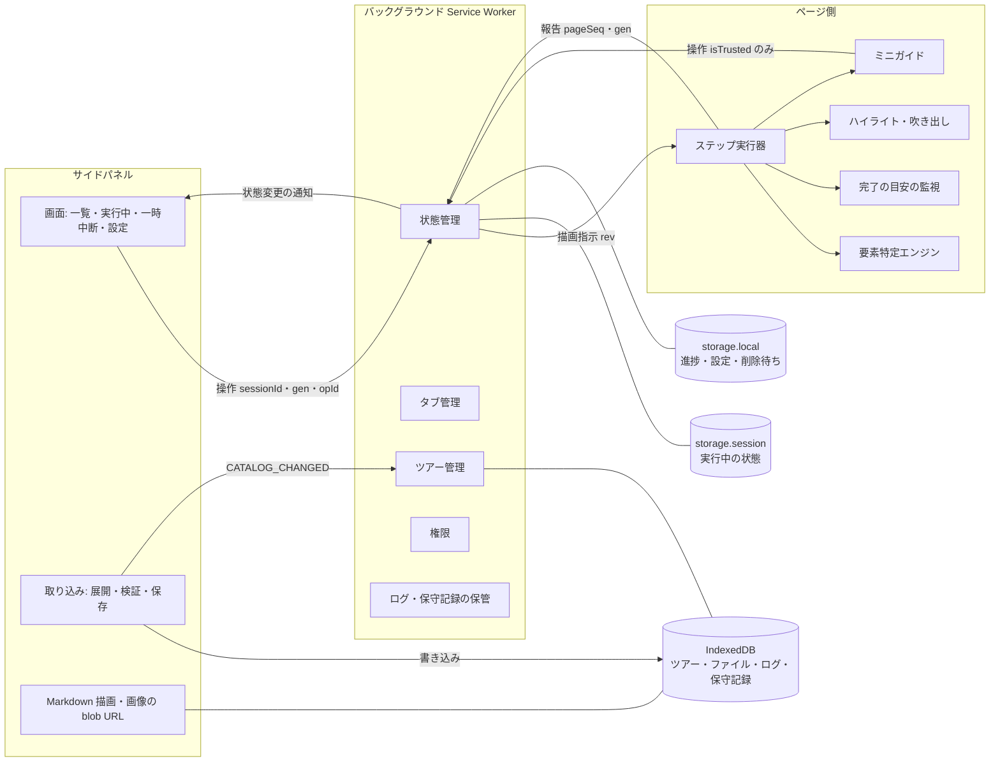

# 構成

## 全体

- **バックグラウンド**だけが実行中の状態を持つ。状態を更新する処理は、すべて1本の列（直列化キュー）に並べて順に処理する。列の中では、YAML・zip・画像の解析のような重い処理を行わない
- **サイドパネル**は、表示、操作の受付、取り込み（展開・検証・IndexedDB への保存）、Markdown と画像の表示を担う
- **ページ側**は、報告（特定結果・目安の状態・ログ）を送る。状態を変える要求を送れるのは、ミニガイド・吹き出し・表示を戻すボタンへの利用者の実際の操作（`isTrusted`）があったときだけ

## 識別子と、古いものを捨てる規則

| 識別子 | 内容 | 変わるとき | 使い方 |
|---|---|---|---|
| `sessionId` | 実行回の ID（ランダム） | 開始・最初からやり直し・新版での再開 | 別の実行回からの操作と報告を捨てる |
| `gen` | 表示世代（実行回の中で単調に増える） | ステップに入るたび（移動・開始・再開） | 移動などのステップに依存する操作は、表示中の `gen` が現在と一致するときだけ受け付ける |
| `pageSeq` | ページ世代（単調に増える） | 役割のタブで、新しい文書の読み込み、または同じ文書内の URL 変更（SPA）を検知したとき | 報告の `pageSeq` が現在と違えば捨てる |
| `rev` | 描画の版（storage.session に保存し、実行回をまたいで単調に増える） | ページ側への指示を送るたび | ページ側は、受け取った最大の `rev` より小さい指示（RENDER・CLEAR・RECHECK など）を捨てる |
| `opId` | 操作の ID | 操作のたび | 同じ操作が重複して届いても、1回だけ処理する |
| `sender` | Chrome が付ける送信元（`tab.id`・`frameId`・`documentId`・`url`） | - | 本文の自己申告ではなく、これで送信元を確かめる。ただし `url` は同じ文書内の URL 変更（`pushState`）に追従しないため、ページの現在の URL の判定には使わず、`chrome.tabs` で取得したタブの URL を使う |

操作ごとの受け付け条件は次のとおりです。

| 操作 | 必要な一致 |
|---|---|
| `STOP`・`PAUSE`・`RESUME`・`RESTART`・`RESUME_NEW`・`SET_OVERLAY` | `sessionId` |
| `GOTO`・`BIND_TAB`・`OPEN_IN`・`FOCUS_ROLE`・`RECHECK`・`SCROLL_TO_TARGET` | `sessionId`＋`gen` |
| ページ側からの操作（ミニガイドの移動など） | 上の条件に加えて、`sender.tab.id` が役割のタブ、`sender.frameId === 0`、`sender.documentId` が記録済みの文書 |
| ページ側からの報告 | `sender` の条件＋`sessionId`＋`gen`＋`pageSeq` |

## 状態の確定と保存の順序

直列化キューの中で、1つの操作を次の順で処理します。

1. メッセージを zod で検証し、識別子と `sender` を確認する（違えば捨てる）
2. 次の状態を計算する（`opId` を `recentOpIds` に加える）
3. **storage.session に次の状態を書く**（ここを確定の時点とする）。失敗したら、メモリ上の状態で続け、`saveError` を立てる
4. 進捗を storage.local に書く（`{ sessionId, gen, stepId, stepIndex, savedAt }`）。同じ `sessionId` で、より大きい `gen` の記録がすでにあれば書かない。失敗したら `saveError` を立てる
5. 外への作用を行う（ページ側への CLEAR・RENDER、サイドパネルへの通知）
6. 応答を返す

完了・終了のときは、状態を `ended`（`sessionId` を残した終了の印）として確定してから、進捗を削除します。削除に失敗したら、storage.local の `pendingDeletes` に `{ tourId, sessionId }` を加えます。

## Service Worker 起動時の復帰

1. storage.session から状態を読む
2. `pendingDeletes` の削除をやり直す
3. 進捗の突き合わせ：状態が実行中で、同じ `sessionId` の進捗の `gen` が状態より小さければ、状態に合わせて書き直す。状態が `ended` なら、同じ `sessionId` の進捗を削除する
4. 実行中なら、`rev` を進めて役割のタブに `SYNC{sessionId, gen, rev}` を送る。ページ側は、違う実行回・世代の表示を持っていれば消す。そのうえで現在のステップを描画し直す（同じ世代なら、ページ側は表示の更新だけを行う）

storage.session への書き込みが成功している限り、利用者に見せた状態は保存済みです（手順3の確定の後にしか、手順5の外への作用は起きないため）。これで FR-105 の保証範囲を満たします。

## ディレクトリ

| パス | 内容 |
|---|---|
| `src/core/tour/` | ツアー形式、YAML の解析と制限、行番号、パスの解決、URL 条件 |
| `src/core/package/` | ツアーパッケージの展開・検証・画像ヘッダーの解析（サイドパネルで使う） |
| `src/core/locator/` | 要素特定エンジン（拡張機能 API に依存しない） |
| `src/core/markdown/` | Markdown を許可リストに沿って DOM に変換する処理 |
| `src/shared/` | ロガー（出来事のスキーマ）、メッセージの型と検証、識別子、権限、IndexedDB の定義、移動の受け付けの待ち |
| `src/background/` | 状態管理、タブ管理、ツアー管理、ログ・保守記録の保管、復帰、部品の配線（Chrome API へのつなぎ込み）と、部品の間の約束 |
| `src/content/` | ステップ実行器、完了の目安の監視、ハイライト・吹き出し、ミニガイド |
| `src/sidepanel/` | サイドパネルの画面、取り込み、画像の URL 管理 |
| `public/tours/<id>/` | 同梱ツアー（`tour.yaml`、Markdown、画像）と、一覧の `public/tours/index.json` |
| `tools/` | スキーマ生成、配布用 zip の作成（Node 上で fflate を使う） |

## 技術検証

実装の最初に、Chrome の実機（Playwright で拡張機能を読み込んだ Chromium）で次の6項目を確かめた。すべて成立した。観測値と、Chrome 114 での推定は `docs/tmp/tech-check-result.md` にある。

1. サイドパネルで書いた IndexedDB の Blob を、バックグラウンドとサイドパネルの両方から読める
2. サイドパネルで fflate の逐次展開を行い、上限で打ち切れる
3. `sender.documentId` を取得でき、同じタブの遷移で値が変わる
4. `checkVisibility` に、Chrome 114 の指定の名前と新しい名前の両方を渡せる
5. `_execute_action` のショートカットキーでサイドパネルが開く（自動検査にはできないので、手動で確かめる）
6. ページのスクリプトから、閉じた Shadow DOM の中のボタンに操作を届けられず、実クリックだけが `isTrusted` で見分けられる

結果を反映した箇所は次のとおり。

- 展開の区切り方（項目2）：圧縮側のデータを小さく区切って渡し、展開結果を受け取るたびに合計を確かめる（設計書の取り込みの処理1）
- `sender.url` を使わないこと（項目3）：`sender.url` は `pushState` に追従しないので、ページの現在の URL の判定には使わない（本書の送信元の表）
- `checkVisibility` の新旧の名前（項目4）：両方の名前を渡す（設計書の要素特定エンジンの「表示されているか」）
- `documentId`（項目3）：ページ側の `HELLO` の `sender.documentId` を記録し、操作の送信元の確認に使う（本書の操作ごとの受け付け条件の表）
