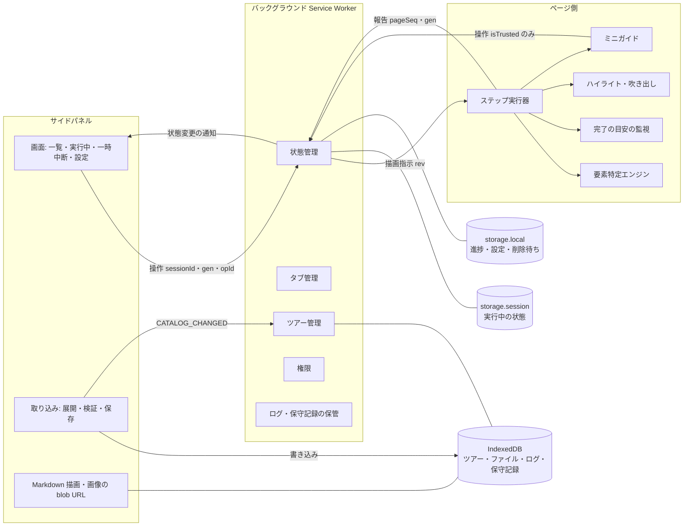

表示調整の方式によって、要件（画面・機能）と設計（ページ上の表示の部品）が大きく変わるので、出し直す前にここを決めます。

# Guided Setup Tour 要件仕様書

## 目的

複数の Web サービスにまたがるセットアップ作業を、実際の画面上で対象箇所を指し示しながら案内します。手順書を読み替える手間による離脱や誤操作を減らすことが目的です。
案内の内容は、拡張機能とは別に配布されるデータ（ツアー、YAML 形式）で定義し、拡張機能そのものは特定のサービスに依存しません。
設計の方針は「**誤って案内する危険を減らすため、確信が持てなければ失敗を選び、失敗しても作業を止めない**」です。これは方針であり、誤った案内が起きないことを保証するものではありません。
本書は**外部から観測できる振る舞い**だけを定義します。内部構造と実装方式は `docs/design.md` に定めます。
社内ツールのため、性能の数値要件は設けません。
「テスト方針」の受け入れ基準をすべて満たしたときを完成とします。

## 範囲

### 対象

- ツアーの読み込みと管理：同梱、取り込み（`.yaml` 単体、またはツアーパッケージ `.zip`）、削除、再読み込み、上書きの確認、不正箇所の提示
- 表示内容：Markdown の説明文（別ファイルへの切り出し可）、画像（PNG・JPEG・WebP・GIF）
- サイトのアクセス許可：ツアーが `origins` で宣言したサイトだけを、開始時に求める
- ツアーの選択・開始・続きから
- 手順の提示：サイドパネル、ページ上のハイライト・吹き出し・ミニガイド
- ミニガイドの表示調整：幅の変更、最小化（右端のバー）、ホバーで開く表示
- 対象要素の特定：意味的な手がかりを優先する段階的な特定、必須の照合、補助の照合、特定後の再検証、見つからないときの文章だけの案内
- 案内だけの手順：ブラウザ外の操作や、対象外の領域（iframe・Shadow DOM）の中の操作を、パネルの案内だけで示す
- 完了の目安の案内（移動の制限も自動の進行もしない）
- 自由なステップ移動：次へ・戻る・一覧から任意のステップへ
- 複数タブ：ページを開く・既存のタブを使う・タブを移すのは、利用者がボタンを押したときだけ
- ページ上の表示を消す・戻す
- 一時中断・終了、進捗の自動保存、内部処理の再起動からの復帰
- ログと設定画面（ログレベル、ミニガイド）、保守記録の確認・書き出し
- ツアーが要求する拡張機能バージョンの確認、拡張機能 ID の固定

### 対象外

- 資料作成モード（スクリーンショットの撮影・手順書の書き出し）：別の仕様書で扱う
- 操作の自動実行、ステップの自動進行、「次へ」の制限
- ページを自動で開くこと、タブを自動で切り替えること
- サイドパネル自体の幅の指定・最小化（Chrome の制約により不可。幅は Chrome の標準機能で利用者が変えられる）
- 旧形式（schemaVersion 2、JSON）のツアーとの互換
- 上書きされたツアーの旧版を保持したまま実行を続けること
- URL 条件での正規表現
- 説明文での HTML の解釈、SVG 画像、外部 URL の画像、動画
- `type="password"` の入力欄の判定（入力の有無も見ない）
- iframe（同一オリジン・別ドメインとも）と Shadow DOM（open・closed とも）の中の要素の特定とハイライト。技術的に不可能だからではなく、本版の範囲の判断として外す。案内だけの手順としては扱う
- ブラウザ外の UI の検知・ハイライト（案内だけの手順としては扱う）
- 要素が他の要素に隠れているか、実際に操作できるかの判定
- 同じ URL 上での、アカウントやプロジェクトの違いの判定
- ツアーの配布元の検証（署名など）
- 性能の数値要件
- ログや記録の外部への送信
- ツアーの画面上での編集
- 案内文の多言語化（要素の照合に使う名前だけは、日本語と英語などの候補を持てる）

## 前提と制約

### 安全性の保証範囲

本製品は社内で配布するツールです。悪意あるツアーへの対策は、次の「仕組みで防ぐ」範囲に絞ります。

| 区分 | 内容 |
|---|---|
| 仕組みで防ぐ | ① ツアーによる任意コードの実行 ② 拡張機能が、ページから取得した情報・ログ・保守記録を外部へ送信すること ③ `origins` で宣言されたサイト以外への権限要求・介入 ④ 入力値を、判定の処理の後まで保持すること、記録・送信すること ⑤ ツアーによって拡張機能全体が固まり、終了の操作が効かなくなること ⑥ 同梱ツアーや取り込み済みのツアーが、警告なしに差し替わること |
| 保証しない（運用で対処する） | ツアーの指示内容の正しさ（例：「このサイトにトークンを貼り付けてください」という誘導）、悪意あるページによる ID・役割・名前の偽装、利用者が指示に従って行う操作の安全性、過大な画像などによる一時的な重さ、対象ページ自身が行う通信（スクロールに伴う遅延読み込みなどを含む）、利用者のリンク操作やページを開く操作に伴う通信 |

DOM の照合は、対象の候補が指定と矛盾しないかの確認です。ページや案内内容が本物であることの確認ではありません。

### 対応環境

- **NFR-01** Chrome および Chromium 系ブラウザ（バージョン 114 以降）で動作すること。

### 受講者の操作を妨げないこと

- **NFR-02** ハイライトは、ページ上のいかなる操作も妨げないこと。吹き出しはその場ですぐ消せること。ミニガイドはその場ですぐ最小化できること。
- **NFR-03** 自動スクロールは、ステップに入ってから初回の探索時間（8秒）の間に特定でき、対象のタブが注目中のときの1回だけとすること。それ以外のときに、利用者が見ている位置を奪わないこと。
- **NFR-04** ツアーの不具合が、セットアップ作業そのものの完遂を妨げないこと。ステップの移動は常に可能であること。
- **NFR-05** サイドパネルのすべての操作（開始・移動・表示の切り替え・一時中断・終了・取り込み・上書きの確認・設定）と、ページ上の操作（吹き出しの ×、ミニガイドの全操作、表示を戻すボタン）を、キーボードだけで行えること。

### セキュリティ・プライバシー

- **NFR-06** 入力欄の値は、完了の目安の判定で文字数を求めるために、その場で参照するだけとすること。判定の処理の後まで値を保持せず、比較・ログ記録・送信もしないこと。
- **NFR-07** `type="password"` の入力欄は、完了の目安の判定対象にしないこと（文字数も見ない）。
- **NFR-08** 要素の特定でページの文字列（読み上げ名・表示文字列）を参照する場合も、使うのは照合の結果（一致したか）だけとすること。文字列そのものを保持・ログ記録・送信しないこと。
- **NFR-09** ツアーは宣言的なデータだけで構成し、実行可能なコードを含められないこと。説明文中の HTML は解釈しないこと。Markdown から生成する要素・属性・URL の方式は、許可リストに限ること。
- **NFR-10** ツアーの URL 条件には正規表現を使えないこと。照合にかかる手間がパターンと URL の長さで抑えられる、構造化した条件だけを受け付けること。パターンの長さと区間数には上限を設けること。
- **NFR-11** YAML は、独自タグを受け付けないこと。エイリアスの展開数、入れ子の深さ、重複したキーに制限を設け、違反したツアーは取り込まないこと。
- **NFR-12** 画像は、許可した種類（PNG・JPEG・WebP・GIF）に限り、拡張子とファイルの先頭部分（署名・ヘッダー）の両方で確認すること。縦横の画素数は、画像を展開する前にヘッダーから確認すること。data URL も、許可した画像の MIME 型に限ること。
- **NFR-13** 権限を求める根拠は、ツアーの `origins` だけとすること。ページに介入するのは、現在の URL が実行中のツアーの `origins` に含まれる場合だけとすること。別のツアーで得た権限が残っていても、それを理由に介入の範囲を広げないこと。
- **NFR-14** 拡張機能は、閲覧中のページから取得した情報、ログ、保守記録を外部へ送信しないこと。外部 URL の画像を読み込まないこと。
- **NFR-15** ログ（コンソールへの出力を含む）と保守記録には、あらかじめ出来事ごとに定めた項目（種類・件数・時間・内部 ID などの列挙値と数値）だけを記録すること。入力値、ページ上の文字列、URL、例外のメッセージは記録しないこと。
- **NFR-16** ページ上のミニガイド・吹き出し・表示を戻すボタンは、利用者の実際の操作だけを受け付けること。ページのスクリプトが発生させた操作では動かないこと。
- **NFR-17** 悪意あるツアーの実行中や取り込み中でも、サイドパネルからの終了・一時中断の操作を受け付けられること。

### 権限

- **NFR-18** 導入時に、いかなるサイトへのアクセス権限も要求しないこと。ただし、タブの URL を判定するためのタブ情報の権限は導入時に要求する。そのため、導入時に Chrome が「閲覧履歴の読み取り」に関する警告を出す。
- **NFR-19** ツアーの実行中に限ってページへ介入すること。ツアーを開始していない間、および終了・完了した後は、閲覧中のページに一切影響を与えないこと（表示・監視・探索をすべて止める）。

### 保守性

- **NFR-20** ツアーの追加・修正に、拡張機能本体の変更を伴わないこと。
- **NFR-21** 対象サイトの画面変更のうち、本製品の探索方式で表せるもの（対象外の領域への移動を除く）は、ツアーデータの修正で回復できること。
- **NFR-22** ツアーの記述誤りは、作成者が自力で直せる粒度（ファイル名・行番号・項目の場所・理由）で通知すること。

### 容量

- **NFR-23** 取り込むツアーには、1件あたりの上限（zip の圧縮サイズ、展開後の合計、ファイル数、画像1枚の容量と画素数）と、取り込み済みツアーの合計容量の上限を設けること。上限は展開の途中でも適用すること。複数のファイルを同時に取り込んでも、合計容量の上限を超えないこと。上限を超えたツアーは、理由を示して取り込まないこと。上限値は design.md に定める。

### 制約

| # | 内容 |
|---|---|
| C-01 | 案内対象サイトの画面構造は変わりうる。ツアーは古くなる前提で保守する |
| C-02 | 拡張機能本体は自動では更新されない。更新は再配布と、利用者の手動操作による |
| C-03 | ブラウザ外の UI（OS のファイル選択ダイアログ、CLI 等）は検知もハイライトもできない |
| C-04 | 拡張機能が判定できるのは URL までで、同じ URL 上のアカウントやプロジェクトの違いは判定できない |
| C-05 | 読み上げ名は拡張機能の中で計算する。ブラウザのアクセシビリティツリーと完全に一致する保証はない |
| C-06 | 「表示されている」かは描画されているかだけを判定する。他の要素による遮蔽や、操作できるかは判定しない |
| C-07 | ホストの権限はポートを区別できない。`origins` にポートを書いても、権限はホスト単位で求める |
| C-08 | Chrome のサイドパネルは、拡張機能から幅の指定や最小化ができない。開くには、ツールバーのアイコンかショートカットキーを使う |
| C-09 | ミニガイド・吹き出し・ハイライトは、アクセス許可があり、URL 条件に合うページにだけ描ける |
| C-10 | 組織のポリシーで拡張機能の導入が禁止されている環境では利用できない |
| C-11 | 案内文は日本語だけを提供する。対象サイトの表示言語は利用者によって異なりうる（日本語が中心で、一部英語） |

## 構成

外部から見た構成（利用者と画面）を示します。

### 用語

| 用語 | 定義 |
|---|---|
| ツアー | 目的を達成するための手順一式を定義した YAML データ |
| ツアーパッケージ | `tour.yaml` と、それが参照する Markdown・画像をまとめた zip ファイル |
| 出所 | ツアーが同梱か取り込みか |
| ステップ | ツアーを構成する単位 |
| 案内だけの手順 | ページを照合せず、ページ上にも何も表示しないステップ |
| URL 条件 | ステップを行うページの条件。オリジンとパス（完全一致・前方一致・ワイルドカード）で書く |
| 完了ページ | 完了の目安として指定した URL 条件に合うページ。ステップの URL 条件に合わなくても、不一致として扱わない |
| 対象要素 | ステップで操作すべき画面上の要素（操作対象）。ハイライトは、操作対象を含む別の要素に読み替えられる |
| 探索の手がかり | 操作対象の候補を集めるための指定（ID、役割と名前、ラベル、表示文字列、構造） |
| 必須の照合 | 候補が満たさなければ採用しない条件（役割、入力の種類、所属する領域、名前） |
| 補助の照合 | 一致しなくても採用するが、保守記録に残す条件（名前の候補） |
| 名前 | 要素の読み上げ名・ラベル・表示文字列。表示言語によって変わりうる |
| 選択中のタブ | そのタブが属するウィンドウで選択されているタブ |
| 注目中のタブ | フォーカスのあるウィンドウで選択されているタブ |
| サイドパネル | ブラウザ画面の横に常駐する、Chrome 標準の案内領域。すべての操作と詳しい説明を持つ |
| ミニガイド | ページの右端に出す、小さな案内領域。ステップ番号・見出し・短い補足・完了の目安・移動のボタンを持つ |
| 吹き出し | 対象要素の近くに出す、見出しと短い補足の表示 |
| ハイライト | 対象要素を枠で強調し、周囲を減衰させる表示 |
| ページ上の表示 | ハイライト（枠と減衰）と吹き出し。× で一括して消せる。ミニガイドは含まない |
| 文章だけの案内 | 対象要素を特定できないときに、文章だけで案内する状態 |
| 完了の目安 | 満たすと「次へ進めます」と案内する条件。移動を制限せず、自動でも進めない |
| 役割 | ツアー内でのタブの識別名。1つの役割に1つのタブを対応付ける |
| 進捗 | ツアーごとに保存する、現在のステップ |
| 保守記録 | 対象要素の特定が想定どおりでなかったことの記録。理由の種類と件数だけを持つ |

### 利用者

| 利用者 | 行うこと |
|---|---|
| 受講者 | ツアーに従ってセットアップを完了する |
| ツアー作成者 | ツアーを記述・検証・保守する。プログラミングの知識は不要 |
| 配布者 | 拡張機能とツアーを配布する |

### 画面

| 画面 | 内容 |
|---|---|
| サイドパネル：一覧 | ツアーの一覧（出所・許可・要確認の表示）、取り込みエリア、再読み込み |
| サイドパネル：実行中 | 現在のステップの説明、完了の目安、タブの操作ボタン、「対象を表示」「再確認」、全ステップの一覧、移動・中断・終了、保存の状態 |
| サイドパネル：一時中断中 | 中断の理由、理由に応じた選択肢 |
| サイドパネル：設定 | ログレベル、ミニガイドの表示の有無、保守記録とログの確認・書き出し・消去 |
| ページ上 | ハイライト、吹き出し（× で消す）、ミニガイド（展開・最小化・ホバー）、表示を戻すボタン（ミニガイドを使わない設定のときだけ） |

## 部品

外部から見える機能要件を、機能のまとまりごとに示します。

### ツアーの取得と管理

- **FR-01** `.yaml` / `.yml` の単体ファイル、または最上位に `tour.yaml` を含む `.zip` を取り込めること。ドラッグ＆ドロップとファイル選択の両方に対応すること。
- **FR-02** 複数のファイルを一度に取り込めること。
- **FR-03** 取り込んだツアーは個別に削除できること。
- **FR-04** 拡張機能に同梱されたツアーも利用できること。同梱ツアーは削除できないこと。
- **FR-05** 取り込むツアーの ID が既存のツアーと同じ場合は、上書きするかを利用者に確認すること。同梱ツアーを置き換える場合は、その旨を確認の画面で明示すること。そのツアーが実行中の場合は、上書きすると一時中断することも確認の画面で示すこと。上書きを承認したときだけ、取り込んだものを優先すること。
- **FR-06** 取り込んだツアーを削除すると、同じ ID の同梱版があれば再び使われること。
- **FR-07** 一覧と実行中の画面で、ツアーの出所（同梱／取り込み）を常に表示すること。
- **FR-08** 利用者の操作で、ツアーを再読み込みできること。
- **FR-09** 不正なツアーは取り込まず、ファイル名・行番号・項目の場所・理由を示すこと。他のツアーの動作に影響を与えないこと。
- **FR-10** 取り込みに成功したとき、ツアー名と対象サイトを示すこと。対象の指定に必須の照合がないなど、誤った案内につながりやすい書き方があれば、取り込んだうえで警告を示すこと。
- **FR-11** 拡張機能を更新したら、同梱ツアーの最新版がすぐに一覧へ反映されること。
- **FR-12** zip の中のファイル名に、重複（大文字・小文字の違いだけのものを含む）、絶対パス、`..` を含むもの、区切り文字を変形したもの（`¥` など）がある場合は、取り込まないこと。
- **FR-13** 取り込んだツアーは、パッケージに含まれる説明文・画像を含めて保存すること。ブラウザの再起動や再読み込みの後も、保存したデータだけから元どおりに表示できること。

### 表示内容

- **FR-14** 説明文は Markdown で書けること。見出し、段落、強調、インラインコード、コードブロック、箇条書き、番号付きリスト、表、リンク、画像に対応すること。
- **FR-15** 説明文中の HTML は解釈せず、タグも含めて文字列のまま表示すること。
- **FR-16** 説明文は YAML に直接書くか、パッケージ内の Markdown ファイルを参照できること。
- **FR-17** 画像は PNG・JPEG・WebP・GIF（アニメーションを含む）を使えること。参照先は、パッケージ内の相対パスか、許可した画像の data URL に限ること。相対パスは参照元ファイルの場所を起点とし、サブディレクトリも可とする。パッケージの中に留まる範囲であれば `..` も使える。
- **FR-18** SVG、外部 URL の画像、パッケージの外を指すパス、絶対パスは、取り込み時にエラーとすること。`.yaml` 単体のツアーでは、相対パスによる参照をエラーとすること。
- **FR-19** 画像には代替文を必須とすること。画像が表示できない場合は代替文を表示し、説明文だけで手順を理解できる状態を保つこと。
- **FR-20** リンクは http / https のものだけを有効にし、新しいタブで開くこと。リンクの文字の横にリンク先のホスト名を表示し、ツアーの `origins` に含まれないホストであれば、その旨を示すこと。
- **FR-21** 吹き出しとミニガイドには、ステップの見出しと短い補足（強調とインラインコードのみ）を表示すること。詳しい説明文と画像は、サイドパネルに表示すること。

### サイトのアクセス許可

- **FR-22** 導入した時点では、いかなるサイトへのアクセス権限も持たないこと。
- **FR-23** ツアーは `origins` で対象のサイトを宣言すること。宣言のないツアーと、ワイルドカードを含むホストを宣言したツアーは受け付けないこと。
- **FR-24** タブの開く URL、ステップで開く URL、ステップの URL 条件と完了の目安の URL 条件のオリジンは、`origins` に含まれていなければならないこと。含まれないツアーは、取り込み時にエラーとすること。
- **FR-25** ツアーの開始時に、`origins` に対してだけアクセス許可を求めること。
- **FR-26** 許可が得られない場合はツアーを開始せず、必要なサイトを示すこと。
- **FR-27** 一覧上で、ツアーごとに許可の有無が分かること。
- **FR-28** 実行中に許可が取り消された場合は、それを検知してツアーを一時中断し、ページ上の表示とミニガイドを消し、再び許可する手段を示すこと。

### ツアーの選択と開始

- **FR-29** 利用できるツアーの一覧（名称・概要・ステップ数・対象サイト・出所・要確認の有無）を示すこと。
- **FR-30** 一覧から任意のツアーを選んで開始できること。
- **FR-31** 進捗が残っているツアーには「続きから」と「最初から」の両方を示し、到達したステップと保存日時を表示すること。
- **FR-32** 拡張機能が、ツアーの要求するバージョンを満たさない場合は開始せず、現在のバージョンと必要なバージョンを示すこと。
- **FR-33** 開始時にページを自動で開かないこと。必要なタブが無い場合は、FR-73 の手段を示すこと。
- **FR-34** 実行中のツアーは、開始した時点の内容に固定すること。
- **FR-35** 実行中に同じ ID のツアーが上書きされた場合は一時中断し、次の3つから選べるようにすること。新しい内容で `origins` が増えている場合は、再開の前にアクセス許可を求め直すこと。旧版を保持したまま続ける選択肢は設けない。
  - 新版で続きから（同じ stepId のステップから。無ければ最初から）
  - 新版で最初から
  - 終了
- **FR-36** 実行中のツアーが削除された場合は終了し、ページ上の表示・ミニガイド・進捗を消すこと。
- **FR-37** 改訂後のツアーで「続きから」を選んだ場合は、保存した stepId のステップから再開すること。stepId が同じでも内容が変わっている可能性があることは受け入れる（ツアー作成者が stepId の意味を保つ運用とする）。

### 手順の提示

- **FR-38** 常に「現在のステップ」が1つだけあり、全体の中での位置（n/N）が分かること。
- **FR-39** サイドパネルに、現在のステップの見出し・説明文・補足画像、および全ステップの一覧（現在より前／現在／現在より後の区別）を表示すること。吹き出しは、ミニガイドと重ならない位置に置くこと。
- **FR-40** 対象要素を特定できたら、その要素をハイライトし、周囲を減衰表示し、吹き出しを表示すること。
- **FR-41** ステップに入ってから8秒以内に対象要素を特定し、対象のタブが注目中で、要素が画面外にあれば、見える位置まで1回だけスクロールすること。8秒を過ぎてから特定した場合と、対象のタブが注目中でない場合はスクロールしないこと。
- **FR-42** サイドパネルとミニガイドに「対象を表示」を置き、押されたら対象要素の位置までスクロールすること。
- **FR-43** 対象要素の位置や大きさが変わったら、ハイライトと吹き出しが追従すること。
- **FR-44** 対象要素を持たないステップを定義できること。この場合は、サイドパネルとミニガイドだけで案内すること。
- **FR-45** 案内だけの手順では、ページやタブを照合せず、不一致の警告も出さず、ページ上には何も表示しないこと（ミニガイドと表示を戻すボタンを含む）。サイドパネルには、ブラウザの外などで行う手順であることを示すこと。
- **FR-46** ショートカットキーでサイドパネルを開けること。キーの割り当ては、Chrome の拡張機能のショートカット設定で利用者が変えられること。

### ミニガイド

- **FR-47** ミニガイドは、ツアーの実行中に、現在のステップの役割のタブが URL 条件に合うページ、または完了ページを表示しているときだけ、そのタブのページの右端に表示すること。案内だけの手順、ページ不一致、無関係なタブでは表示しないこと。
- **FR-48** ミニガイドには、ステップ番号（n/N）、見出し、短い補足、完了の目安の状態、文章だけの案内のときの案内文、「次へ」「戻る」「対象を表示」、ページ上の表示が消えているときの「表示を戻す」、サイドパネルを開く方法の案内を表示すること。
- **FR-49** ミニガイドは、次の3つの表示状態を切り替えられること。

| 状態 | 振る舞い |
|---|---|
| 展開 | 右端に固定して表示する。左の境界をドラッグして幅を変えられる |
| 最小化 | 右端に細いバーだけを残す。バーには、ステップ番号と完了の目安の状態を表示する。クリックすると展開する |
| ホバー | 普段はバーだけを表示し、マウスを乗せている間（またはキーボードでフォーカスしている間）だけ展開する |

- **FR-50** ミニガイドの表示状態と幅は、ツアーやページをまたいで保持し、ブラウザを再起動しても失われないこと。幅は、design.md に定める最小値と最大値の範囲に収めること。
- **FR-51** ミニガイドの「次へ」「戻る」は、サイドパネルの同じ操作と同じ規則（FR-56〜59）で動くこと。
- **FR-52** ミニガイドの表示状態は、ページ上の表示（ハイライト・吹き出し）の表示・非表示と連動しないこと。
- **FR-53** 設定画面で「ミニガイドを表示しない」を選べること。選んだ場合は、ミニガイドを一切表示しないこと。

### ステップの移動

- **FR-54** 「次へ」と「戻る」は常に押せること。ただし、最初のステップでは「戻る」が無効になり、最終ステップでは「次へ」の代わりに「完了」が表示される。
- **FR-55** サイドパネルのステップ一覧から、任意のステップへ直接移れること。
- **FR-56** 拡張機能がステップを自動で進めないこと。
- **FR-57** 同じ表示から受け付ける移動の操作は、最初の1回だけとすること。連打や、古い表示からの操作で、二重に移動しないこと。サイドパネルとミニガイドで同時に操作した場合も、1回だけ移動すること。
- **FR-58** 最終ステップで「完了」を押したら、ツアーが完了したことを示し、そのツアーの進捗を破棄すること。
- **FR-59** 完了または終了の後は、すべてのタブからページ上の表示とミニガイドを消し、探索と監視を止めること。

### 完了の目安

- **FR-60** ステップごとに、任意で完了の目安を定義できること。種類は、完了ページ（URL 条件）、要素の出現、要素の状態（入力済み、チェック済み、ARIA の状態〔選択・展開・押下など〕）とする。
- **FR-61** 完了の目安を満たしたら、サイドパネル・ミニガイド・吹き出しで「次へ進めます」と案内すること。満たしていない間は、何をすればよいかを案内すること。
- **FR-62** 完了の目安は、ステップの移動を制限せず、自動の進行も行わないこと。
- **FR-63** 役割のタブが完了ページを表示している場合は、ステップの URL 条件に合わなくても不一致として扱わないこと。「次へ進めます」と案内し、正しいページへ戻す案内は出さないこと。完了ページでは、ミニガイドは表示するが、対象要素の探索とハイライトは行わないこと。
- **FR-64** 要素の出現・状態の完了の目安は、ステップにいて対象のタブが選択中の間は判定し続けること。満たさなくなったら（入力を消したなど）、案内も満たしていない状態に戻すこと。ページのイベントを伴わずに値が変わった場合も、短い間隔の確認で案内へ反映すること。
- **FR-65** 対象のタブが選択中でない間は判定を止め、サイドパネルには「確認を停止中」と示すこと。
- **FR-66** 入力済みの判定対象が `type="password"` の欄だった場合は判定せず、「この項目は確認できません」と示して、文章で案内すること。
- **FR-67** 状態を判定する要素と、ハイライトする要素を、別々に指定できること（例：チェックボックスの状態を読み、ラベル全体をハイライトする）。

### URL 条件

- **FR-68** URL 条件は、オリジン（完全一致）とパスで書くこと。パスの条件は、完全一致・前方一致・ワイルドカード（`*` はパスの1区間、`**` は0個以上の区間に一致）から選ぶこと。
- **FR-69** パスの前方一致とワイルドカードは、区間（`/` で区切られた単位）ごとに比べること。例えば、`/project` の前方一致は `/project/settings` に一致し、`/project-danger` には一致しない。
- **FR-70** URL のクエリ（`?` 以降）とフラグメント（`#` 以降）は、条件の判定に使わないこと。パスの末尾の `/` の有無は区別しないこと。パスは、ブラウザが正規化した形のまま、大文字・小文字を区別して比べること。

### 対象要素の特定

- **FR-71** ツアーは、対象要素について、探索の手がかり、必須の照合、補助の照合、ハイライトする要素への読み替えを指定できること。
- **FR-72** 探索の手がかりは、次の段階の順で試すこと。ツアーは、1つのステップに複数の段階の手がかりを書けること。
  1. 案内用の ID・テスト用の ID
  2. 役割と読み上げ名
  3. 入力欄のラベル
  4. 表示文字列
  5. 構造による指定
- **FR-73** 各段階では、次の順に処理すること。操作対象がちょうど1つに決まらなければ（0件、または2件以上）、その段階は採用せずに次の段階へ移ること。
  1. 探す範囲を決める
  2. 操作対象の候補を集める
  3. 必須の照合で絞る
  4. 表示されているかを確認する
  5. **操作対象がちょうど1つであることを確認する**
  6. ハイライトする要素へ読み替える
  7. 読み替えた要素が表示されていて、不適格でないことを確認する
- **FR-74** 複数の操作対象が同じハイライト要素に読み替えられても、操作対象が1つに決まったとはみなさないこと。
- **FR-75** 探す範囲の指定が一意に決まらない場合は、その範囲を使う手がかりを失敗とすること。範囲を無視してページ全体に広げないこと。
- **FR-76** どの段階で見つかった候補でも、必須の照合を満たさなければ採用しないこと。必須の照合には名前も指定できること。
- **FR-77** 名前は、複数の候補を書けること。候補のいずれかに一致すれば一致とみなすこと。段階2〜4では名前を探索に使い、段階1と5では補助の照合に使うこと（必須の照合に名前を指定していなければ、一致しなくても採用し、保守記録に残す）。
- **FR-78** 「表示されている」とは、要素が描画用の矩形（大きさ）を持ち、要素自身と祖先の非表示・透明化の指定によって描画が抑えられていないことをいう。祖先自身が矩形を持つことは求めない。画面外にあることは、非表示とみなさない。表示されていない要素は、ハイライトの対象にしないこと。完了の目安の判定に限り、指定があれば非表示の要素も対象にできること。
- **FR-79** 読み替えた要素が `html`・`body`、または表示領域全体を覆う要素である場合は、不適格として採用しないこと。表示領域より大きくても、全体を覆わない要素（長いフォーム、大きな表など）は採用できること。
- **FR-80** 対象要素の特定は、次のように振る舞うこと。

| 場面 | 振る舞い |
|---|---|
| 探索の開始 | ステップに入ったとき、再開したとき、再確認のとき、タブが選択中に戻ったときは、すぐに1回探索する |
| 初回の探索 | 8秒以内に特定できなければ、文章だけの案内に切り替える。代替文があればそれを使い、なければ名前の候補から案内文を作る |
| 8秒以降 | ステップにいる間は、低い頻度で探し続ける。見つかったらハイライトに切り替える（スクロールはしない） |
| 特定後の再検証 | ハイライト中も、ページが変化したときと定期的に特定をやり直す。FR-81 の条件のいずれかに当たれば、古いハイライトと吹き出しをすぐに消して探し直す |
| 再確認 | サイドパネルの「再確認」で、初回の探索をやり直す |
| 停止 | 一時中断、ステップの移動、終了、完了、対象タブが選択中でなくなったときは、そのステップの探索と監視を止める |

- **FR-81** 再検証で、次のいずれかに当たった場合は、ハイライトを消すこと。間隔は design.md に定める。
  - 操作対象が一意でなくなった（同じ条件の候補が増えたなど）
  - 今の要素が操作対象として選ばれなくなった（要素が消えた、入れ替わった）
  - 必須の照合を満たさなくなった（名前・役割・所属する領域・入力の種類が変わったなど）
  - 操作対象、または読み替えた要素が表示されなくなった
  - 読み替えた要素が不適格になった
  - 現在のページが、介入の条件（URL 条件と `origins`）から外れた
- **FR-82** 再検証で補助の照合（名前）だけが一致しなくなった場合は、ハイライトを残し、保守記録に残すこと。
- **FR-83** 古いページ・古い表示から届いた探索結果や目安の判定結果は、採用しないこと。同じタブで別のページへ移った後に届いた結果や、同じステップ番号に戻った後に届いた古い結果も含む。

### 複数タブ・複数サイト

- **FR-84** ツアーは、複数のサイトにまたがれること。各ステップは、どの役割のタブで行うかと、URL 条件を宣言すること（案内だけの手順を除く）。
- **FR-85** 役割にタブが対応付けられていない場合は、次の手段を示すこと。どれも、利用者が選んだときだけ行う。
  - 「このタブを○○として使う」（注目中のタブが URL 条件に合うとき）
  - URL 条件に合う既存のタブの一覧からの選択（別ウィンドウのタブを含む）
  - 「今のタブで開く」「新しいタブで開く」
- **FR-86** 1つのタブは、1つの役割だけに対応付けること。すでに別の役割に対応付けられたタブを選んだ場合は、その旨を示し、付け替えるかどうかを利用者に確認すること。
- **FR-87** ページを自動で開かないこと。タブを自動で切り替えないこと。
- **FR-88** ページが合っているかは、ステップの URL 条件と、ツアーの `origins` の両方で判定すること（完了ページは FR-63 による）。
- **FR-89** 現在のステップと無関係なタブには、何も表示しないこと。
- **FR-90** 役割のタブが注目中でない場合は、「○○のタブへ移動」を示し、押されたらそのタブとウィンドウを前面に出すこと。
- **FR-91** 役割のタブが URL 条件にも完了ページにも合わないページを表示している場合は、ページ上の表示とミニガイドを消し、そのタブで正しいページを開く手段を示すこと。新しいタブを自動で作らないこと。
- **FR-92** 役割のタブが閉じられてもツアーは続き、FR-85 の手段で再び対応付けられること。

### ページ上の表示の制御

- **FR-93** 受講者は、ページ上の表示（ハイライト・減衰・吹き出し）を、吹き出しの × かサイドパネルから一括で消せること。ミニガイドは消えずに残ること。
- **FR-94** 消している間も、サイドパネルとミニガイドの案内、完了の目安の判定は続けること。
- **FR-95** 消している間は、ミニガイドとサイドパネルに「表示を戻す」を示すこと。「ミニガイドを表示しない」の設定のときは、代わりにページ上に表示を戻すボタンを示すこと。ただし、ページ上に何かを表示するのは、ツアーの実行中で、現在のステップ（案内だけの手順を除く）の役割のタブが、URL 条件に合うページか完了ページを表示している場合に限ること。
- **FR-96** 表示を消した状態はツアー全体の設定として保持し、ページを移動しても勝手に戻らないこと。

### 中断・再開・終了・復帰

- **FR-97** ステップを移るたびに、進捗を自動で保存すること。保存した進捗は、ブラウザを終了しても失われないこと。
- **FR-98** 進捗の保存、または復帰用の実行状態の保存に失敗しても、ツアーの操作は続けられること。失敗している間は、サイドパネルに「保存されていません。再起動すると前の位置に戻る可能性があります」と示すこと。
- **FR-99** 一時中断すると、ページ上の表示とミニガイドをすべて取り除き、探索と判定を止めること。一時中断中は、中断の理由と、理由に応じた選択肢を示すこと。

| 中断の理由 | 選択肢 |
|---|---|
| 利用者の操作 | 再開、最初からやり直し、終了 |
| 許可の取り消し | 再び許可して再開、終了 |
| ツアーの上書き | 新版で続きから、新版で最初から、終了（FR-35） |

- **FR-100** 終了すると、進捗を破棄すること。次回は最初から開始されること。
- **FR-101** 完了・終了のときに進捗の削除に失敗した場合も、完了・終了の表示は出すこと。削除は次回の起動時にやり直すこと。
- **FR-102** 一時中断と終了の違いを、画面上で説明すること。
- **FR-103** ツアーの改訂によって保存されたステップが存在しなくなった場合は、その旨を示し、最初のステップから開始すること。
- **FR-104** 古い表示・古いツアーの実行回から届いた操作（終了、タブの対応付け、ページを開くなど）は、現在の実行中のツアーに作用しないこと。
- **FR-105** 復帰用の実行状態を保存できている場合は、拡張機能の内部処理（Service Worker）がどの時点で停止・再起動しても、実行中のツアーは続くこと。表示が二重になったり、ステップが二重に移動したり、利用者に見せたステップから巻き戻したり、終了・完了したツアーの進捗が復活したりしないこと。復帰用の実行状態の保存に失敗している間は、この保証の対象外とする（FR-98 の表示を出す）。

### 設定

- **FR-106** 設定画面で、ログレベル（エラー／警告／情報／詳細）を選べること。既定は「警告」とする。
- **FR-107** 設定画面で、ミニガイドを表示するかどうかを選べること。既定は「表示する」とする。

### ログと保守記録

- **FR-108** ログは手元にだけ保存すること。件数（2,000件）か期間（30日）のどちらかの上限を超えたら、古いものから自動で削除すること。
- **FR-109** 保守記録は、ログとは別に、ログレベルにかかわらず保存すること。保存するのは、理由の種類・使われた手がかりの段階・候補の件数・件数の累計・最終日時だけとすること。保存件数の上限（1,000件）を超えたら、最終日時の古いものから削除すること。
- **FR-110** 保守記録の理由の種類と、一覧の「要確認」の扱いは次のとおりとすること。

| 結果 | 理由の種類 | 「要確認」 |
|---|---|---|
| ツアーに書かれた最も上位の段階で成功し、補助の照合も一致 | 記録しない（正常） | なし |
| 上位の段階で失敗し、下位の段階で成功 | 劣化 | あり |
| ある段階で必須の照合の前の候補がちょうど1件あり、その候補が必須の照合で捨てられた（手がかりがはっきり別のものを指した） | 矛盾 | あり |
| すべての段階で失敗 | 未検出 | あり |
| 段階1・5で採用した（または再検証した）が、補助の照合（名前）が一致しない | 名前不一致 | あり |

- **FR-111** 必須の照合で候補が絞り込まれただけ（候補が2件以上あり、正しく1件に絞れた場合など）は、保守記録に残さないこと。同じステップを表示している間に同じ結果が繰り返されても、件数は1回だけ数えること。
- **FR-112** 保守記録を、ツアー別・ステップ別にサイドパネルで確認できること。
- **FR-113** ログと保守記録をファイルとして書き出せること。
- **FR-114** ログと保守記録を、利用者の操作で消去できること。

### バージョンの整合

- **FR-115** ツアーは、動作に必要な拡張機能の最低バージョンを宣言できること。

### 配布・導入

- **FR-116** 拡張機能は zip 形式で配布し、展開したフォルダを読み込む方式で導入できること。
- **FR-117** 導入場所が利用者ごとに異なっても、同じ拡張機能 ID として識別されること。
- **FR-118** ツアーは単体ファイル（`.yaml` または `.zip`）として配布でき、画像を含められること。
- **FR-119** 配布物に、秘密鍵その他の機密情報を含めないこと。

## データの流れ

利用者から見た代表的な流れを示します。

### ① 初めてツアーを開始する

1. 受講者がサイドパネルの一覧で「開始」を押す
2. `origins` のサイトの許可を確認するダイアログが出る。許可すると開始される
3. 役割にタブが対応付けられていないので、サイドパネルに「このタブを○○として使う」（注目中のタブが条件に合う場合）、条件に合う既存タブの一覧、「今のタブで開く」「新しいタブで開く」が出る。受講者が選ぶと、そのとおりに対応付ける・開く
4. ページの右端にミニガイドが出る。対象要素がハイライトされ（8秒以内に見つかり、画面外にあれば1回だけスクロール）、近くに吹き出しが出る
5. 操作を終えると、サイドパネル・ミニガイド・吹き出しに「次へ進めます」と表示される。受講者がミニガイドかサイドパネルの「次へ」を押す

### ② 完了ページへ移る

1. ステップの URL 条件は `/tokens/new`、完了の目安は完了ページ `/tokens/created`
2. 作成ボタンを押すと、`/tokens/created` へ移る
3. 不一致の案内は出ず、ミニガイドとサイドパネルに「次へ進めます」と表示される

### ③ ミニガイドを調整する

1. 受講者がミニガイドの左の境界をドラッグして幅を広げる
2. 作業の邪魔になったので最小化する。右端にバー（ステップ番号と目安の状態）だけが残る
3. 次からはホバーにし、マウスを乗せたときだけ開くようにする。この設定は、別のツアーやブラウザの再起動後も保たれる

### ④ ツアーパッケージを取り込む

1. 作成者が `tour.yaml`、`steps/*.md`、`img/**` を zip にまとめて配布する
2. 受講者がサイドパネルにドロップする
3. 同じ ID のツアーがあれば、上書きするかの確認が出る（同梱版の置き換えや、実行中なら一時中断することも示す）
4. 成功すればツアー名・対象サイト・警告が表示される。失敗すれば、ファイル名・行番号・理由が表示される

### ツアーが表現できること

記述形式の詳細は、`docs/AUTHORING.md` に定めます。

| 分類 | 表現できること |
|---|---|
| 識別 | ID、名称、概要、必要な拡張機能のバージョン、形式のバージョン |
| 対象 | 使用するサイト（`origins`）、タブの役割（表示名・開く URL・URL 条件） |
| 手順 | 見出し、説明文（直接記述または Markdown ファイルの参照）、吹き出し・ミニガイド用の短い補足、補足画像、行う役割、URL 条件、案内だけの手順かどうか |
| URL 条件 | オリジン、パスの完全一致・前方一致・ワイルドカード（区間単位） |
| 対象要素 | 探索の手がかり（案内用の ID・テスト用の ID、役割、名前の候補、ラベルの候補、表示文字列の候補、構造による指定）、探す範囲、必須の照合（役割、入力の種類、所属する領域、名前）、ハイライトする要素への読み替え、代替文 |
| 完了の目安 | 完了ページ（URL 条件）、要素の出現、要素の状態（入力済み・チェック済み・ARIA の状態）、状態を判定する要素、非表示の要素を許すか、未達成・達成時の案内文 |

ツアーに実行可能なコードや正規表現を含めることはできません。

### 利用者の端末に保存される情報

| 情報 | 保存期間 |
|---|---|
| 取り込んだツアー（YAML・Markdown・画像） | 削除するまで |
| 進捗 | 終了・完了・ツアーの削除まで |
| 実行中の状態 | ブラウザの終了まで |
| 設定（ログレベル、ミニガイドの表示の有無・表示状態・幅） | 変更するまで |
| ログ | 2,000件または30日の上限まで。消去するまで |
| 保守記録 | 1,000件の上限まで。消去するまで（ツアーを削除したら、そのツアーの分も消える） |

## エラー処理

| 起きること | 利用者に見えること |
|---|---|
| YAML の文法・形式の誤り、YAML の制限（エイリアス・入れ子・重複キー・独自タグ）違反、URL 条件での正規表現、URL 条件の長さ・区間数の超過 | 取り込まれず、ファイル名・行番号・項目の場所・理由が表示される |
| `origins` の外の URL（開く URL・URL 条件）、ワイルドカードのホスト | 取り込まれず、該当する箇所と理由が表示される |
| zip のファイル名の違反、パッケージ外への参照、SVG・外部 URL の画像、画像の署名・ヘッダーの不一致、単体 YAML での相対パス | 取り込まれず、該当する箇所と理由が表示される |
| 1件あたり・合計容量・画素数の上限を超えた | 取り込まれず、超えた上限が表示される |
| 同じ ID のツアーがある | 上書きの確認が出る。承認しなければ取り込まれない |
| 実行中のツアーが上書きされた | 一時中断になり、新版で続きから・新版で最初から・終了を選ぶ |
| 実行中のツアーが削除された | 終了し、表示と進捗が消える |
| サイトの許可を拒否した | 開始されず、必要なサイトが表示される |
| 実行中に許可が取り消された | 一時中断になり、再び許可する手段が表示される |
| 拡張機能のバージョンが足りない | 開始されず、現在のバージョンと必要なバージョンが表示される |
| 対象要素が見つからない | 文章だけの案内になる。移動は通常どおりできる。後から見つかればハイライトに変わる |
| 特定した要素が条件を満たさなくなった | 古いハイライトと吹き出しがすぐに消え、探し直される |
| 候補が必須の照合を満たさない | その候補はハイライトされない（次の段階か、文章だけの案内） |
| 完了の目安の対象が `type="password"` の欄 | 「この項目は確認できません」と表示され、文章で案内する |
| 役割のタブが閉じられた・無い | 既存タブの選択、「今のタブで開く」「新しいタブで開く」が表示される |
| 役割のタブが URL 条件にも完了ページにも合わないページを表示している | ページ上の表示とミニガイドが消え、正しいページを開く手段が表示される |
| ページに表示できない（読み込み中・ブラウザが制限しているページ） | 「このページでは表示できません」と「再確認」ボタンが表示される |
| 保存されたステップがツアーに無い | 「ツアーが更新されたため最初から開始します」と表示される |
| 進捗・実行状態の保存に失敗した | 操作は続けられ、「保存されていません。再起動すると前の位置に戻る可能性があります」と表示され続ける |
| 完了・終了時に進捗の削除に失敗した | 完了・終了は表示される。次回の起動時に削除がやり直される |

## テスト方針

次の受け入れ基準をすべて満たすことを、完成の条件とします。要件と受け入れ基準の対応表は、`docs/design.md` のテスト方針に置きます。

### 基本の動作

| # | シナリオ | 期待結果 |
|---|---|---|
| AC-01 | ツアーを最初から最後まで実施する | 全ステップが順に示され、「完了」で完了が表示される。進捗は破棄される |
| AC-02 | 導入直後に任意のサイトを閲覧する | ページの表示・動作に変化がない |
| AC-03 | ツアーを完了または終了した後に、対象サイトと他のサイトを閲覧する | どのタブにも表示が出ず、探索・監視も行われていない |
| AC-04 | 未許可のツアーを開始する | `origins` のサイトだけの許可確認が出る。拒否すると開始されない |
| AC-05 | 対象要素が最初から存在し、その後ページが変化しない静的なページでステップに入る | すぐに特定され、ハイライトされる |
| AC-06 | 対象要素を削除した状態で該当ステップに入り、10秒後に要素を追加する | 8秒以内に文章だけの案内へ切り替わり、「次へ」で進める。要素を追加するとハイライトに変わり、スクロールはしない。保守記録に「未検出」が残る |
| AC-07 | 完了の目安が入力済みの欄に1文字入力し、その後消す | 自動では進まない。入力すると「次へ進めます」が表示され、消すと元に戻る |
| AC-08 | イベントを発生させずに、スクリプトで入力欄の値を変える | 完了の目安の案内が、短い間隔の確認で変わる |
| AC-09 | 完了の目安を満たさずに「次へ」を押す | 次のステップへ進む |
| AC-10 | ステップ一覧から5番目を選ぶ | 5番目に移り、自動では先へ進まない |
| AC-11 | 「次へ」を素早く連打する。サイドパネルとミニガイドの「次へ」をほぼ同時に押す | どちらの場合も、1ステップだけ進む |
| AC-12 | ステップの URL 条件が `/tokens/new`、完了ページが `/tokens/created` のステップで、作成後に完了ページへ移る | 不一致の案内も、正しいページへ戻す案内も出ない。「次へ進めます」と表示される |
| AC-13 | 役割のタブが無く、条件に合うログイン済みのタブが別ウィンドウにある状態でステップに入る | ページは自動で開かない。既存タブの一覧からそのタブを選べ、選ぶと対応付けられる。「今のタブで開く」「新しいタブで開く」も選べる |
| AC-14 | 役割のタブが URL 条件にも完了ページにも合わないページにある状態で、ステップに入る | タブは増えない。ページ上の表示とミニガイドが消え、正しいページを開く手段が表示される |
| AC-15 | 別のウィンドウで作業中に「次へ」を押す | タブは切り替わらず、自動スクロールも起きない。「○○のタブへ移動」が表示される |
| AC-16 | 役割のタブを選択中でなくする（同じウィンドウの別のタブを選ぶ） | サイドパネルの目安が「確認を停止中」になる |
| AC-17 | 案内対象のタブを閉じ、再び開く | 同じステップから続けられる |
| AC-18 | 吹き出しの × を押し、ページを移動する | ハイライトと吹き出しが消え、ミニガイドは残り「表示を戻す」が出る。移動後も表示は戻らない |
| AC-19 | 「ミニガイドを表示しない」に設定して、吹き出しの × を押す | ミニガイドは出ず、ページ上に表示を戻すボタンが出る |
| AC-20 | 表示を消した状態で、案内だけの手順に入る | ミニガイドと表示を戻すボタンも含め、ページ上に何も表示されない。不一致の警告も出ず、「次へ」で進める |
| AC-21 | 一時中断せずにブラウザを再起動する | 「続きから」で同じステップから再開できる |
| AC-22 | 終了する | 進捗が破棄され、次回は最初から開始される |
| AC-23 | 要求バージョンを満たさないツアーを開始する | 開始されず、更新を促す案内が出る |
| AC-24 | 実行中にサイトの許可を取り消す | 一時中断になり、理由と再び許可する手段が表示される |
| AC-25 | ツアー A の実行で `origins` 外のサイトの権限を得た後、ツアー B を実行し、ツアー B の `origins` 外のそのサイトを開く | そのサイトには何も表示されない |
| AC-26 | キーボードだけで、開始・ステップ移動・表示の切り替え・一時中断・終了・取り込み・上書きの確認・設定の変更・ミニガイドの操作を行う | すべて実行できる |
| AC-27 | ショートカットキーを押す | サイドパネルが開く |

### ミニガイド

| # | シナリオ | 期待結果 |
|---|---|---|
| AC-28 | ミニガイドを最小化し、バーをクリックする | 最小化で右端にバー（ステップ番号と目安の状態）だけが残り、クリックで展開する |
| AC-29 | ミニガイドをホバーにし、マウスを乗せる・外す。キーボードでフォーカスする | 乗せている間とフォーカスしている間だけ展開する |
| AC-30 | ミニガイドの幅を変え、別のツアーを開始し、ブラウザを再起動する | 幅と表示状態が保たれる。幅は最小値・最大値の範囲に収まる |
| AC-31 | ページのスクリプトから、ミニガイドの「次へ」にクリックの操作を発生させる | ステップは移動しない |
| AC-32 | 対象要素が画面の右端にあり、吹き出しがミニガイドと重なりうるステップを表示する | 吹き出しはミニガイドと重ならない位置に出る |
| AC-33 | ミニガイドを最小化した状態で、吹き出しの × を押してから「表示を戻す」を押す | ミニガイドは最小化のまま、ハイライトと吹き出しだけが戻る |

### 取り込みと表示

| # | シナリオ | 期待結果 |
|---|---|---|
| AC-34 | 構文またはスキーマに違反するインデントの誤りを含む YAML を取り込む | 取り込まれず、行番号付きでエラーが表示される |
| AC-35 | Markdown とサブディレクトリの画像（GIF を含む）を含む zip を取り込み、ブラウザを再起動してから表示する | 説明文と画像が正しく表示される |
| AC-36 | パッケージ外への参照、外部 URL の画像、SVG を含むツアーを取り込む | 取り込まれず、該当する箇所と理由が表示される |
| AC-37 | 説明文に `<b>重要</b>` を含むツアーを実施する | タグも含めて文字列のまま表示される |
| AC-38 | 英語表示に設定した GitLab で、同梱のトークン発行ツアーを実施する | 名前の候補による照合で、対象要素がハイライトされる |
| AC-39 | 同梱ツアーと同じ ID のツアーを取り込む | 同梱版を置き換える旨の確認が出る。承認しなければ同梱版のまま。承認すると出所が「取り込み」と表示される |
| AC-40 | `origins` に含まれないホストを、開く URL または完了ページに書いたツアーを取り込む | 取り込まれず、そのホストへの権限も求められない |
| AC-41 | 必須の照合のない対象指定を含むツアーを取り込む | 取り込まれ、警告が表示される |
| AC-42 | 説明文に、`origins` 外へのリンクを含むツアーを実施する | リンクの横にホスト名と、宣言外である旨が表示される |
| AC-43 | URL 条件が `/project` の前方一致のステップで、`/project-danger` を開く | URL 条件に合わないと判定される |
| AC-44 | 合計容量の上限の近くで、複数のツアーを同時に取り込む | 合計容量の上限を超えて保存されない。超える分は理由を示して拒否される |
| AC-45 | 取り込み済みツアーの合計容量の上限を超えるツアーを取り込む | 取り込まれず、上限が表示される |

### 誤った案内の防止

| # | シナリオ | 期待結果 |
|---|---|---|
| AC-46 | 役割 button・名前「削除」の手がかりに対して、最終候補が2件ある画面で実施する | その段階は採用されず、他の段階でも1件に決まらなければ文章だけの案内になる |
| AC-47 | 同じ名前のボタン2つが、指定した同じ祖先に読み替えられる画面で実施する | 操作対象が1つに決まらないため採用しない |
| AC-48 | ID は一致するが、役割または所属する領域が必須の照合と違う要素がある | その要素をハイライトしない。保守記録に「矛盾」が残る |
| AC-49 | 必須の照合に名前を指定し、ID は一致するが名前が違う要素がある | その要素をハイライトしない |
| AC-50 | 探す範囲の指定が複数の要素に一致する | 範囲をページ全体に広げず、その手がかりは失敗として扱われる |
| AC-51 | 読み替え先が `body` になる指定と、表示領域より長いフォームになる指定を、それぞれ実施する | `body` は採用しない。長いフォームは採用する |
| AC-52 | `display: contents` の祖先を持つ要素を対象にする | 表示されている要素として特定される |
| AC-53 | ハイライト中に、ページの再描画で対象要素が入れ替わる | 古い枠がすぐに消え、新しい要素が特定されてハイライトされる。スクロールはしない |
| AC-54 | ハイライト中に、同じ要素の役割・所属する領域を変えて、必須の照合を満たさなくする | 古い枠がすぐに消え、探し直される |
| AC-55 | ハイライト中に、同じ条件に合う候補をもう1つ追加する | 一意でなくなったため、枠が消える |
| AC-56 | ハイライト中に、対象要素の祖先を透明にする | 枠が消える |
| AC-57 | ID で特定してハイライト中に、名前だけを変える（必須の照合に名前を指定していない） | 枠は残り、保守記録に「名前不一致」が残る |

### 非同期処理・改訂・復帰

| # | シナリオ | 期待結果 |
|---|---|---|
| AC-58 | ステップ3で探索中に4へ移り、すぐ3へ戻ったあと、最初の探索結果が遅れて届く | 遅れて届いた結果は採用されない |
| AC-59 | 同じタブで別のページへ移った後に、前のページの探索結果・目安の結果を届ける | 採用されない |
| AC-60 | 古い描画指示・消去指示を、新しいものより後に届ける | 最新の表示が壊れない |
| AC-61 | ツアー A のサイドパネルから送った「終了」「今のタブで開く」を、ツアー B の開始後に届ける | ツアー B に作用しない |
| AC-62 | 実行中に、同じ ID で別の内容のツアーを取り込み、上書きを承認する | 実行中のツアーは勝手に切り替わらず一時中断され、3つの選択肢が出る。`origins` が増えていれば、再開の前に許可の確認が出る |
| AC-63 | AC-62 の後に、「新版で続きから」「新版で最初から」「終了」をそれぞれ選ぶ | それぞれ、同じ stepId のステップ（無ければ最初）から再開、最初から開始、終了になる |
| AC-64 | 実行中のツアーを削除する | ツアーが終了し、ページ上の表示・ミニガイド・進捗が消える |
| AC-65 | 実行中に拡張機能の内部処理（Service Worker）を停止させ、再び操作する | ツアーは続き、表示の二重化やステップの二重移動が起きない |
| AC-66 | 移動・完了・終了の保存処理の各段階で処理を中断させ、復帰させる（実行状態の保存は成功する条件で） | 利用者に見せたステップから巻き戻らず、終了・完了したツアーの進捗が復活しない |
| AC-67 | 進捗と実行状態の保存を失敗させた状態でステップを移る | 操作は続けられ、「保存されていません。再起動すると前の位置に戻る可能性があります」と表示される |
| AC-68 | 進捗の削除を失敗させた状態で、完了・終了する | 完了・終了は表示される。次回の起動時に削除がやり直され、成功すれば「続きから」は出ない |

### 安全性

| # | シナリオ | 期待結果 |
|---|---|---|
| AC-69 | 悪意あるファイル（画像でない data URL、展開すると巨大になる zip、重複したファイル名を含む zip、エイリアスを大量に展開する YAML、重複キーを含む YAML、ファイル容量は小さいが寸法が巨大な画像、大量のファイルを含む zip）を取り込む | すべて拒否され、理由が表示される。取り込み中もサイドパネルの他の操作を受け付ける |
| AC-70 | 正規表現を書いたツアー、上限を超える長さ・区間数の URL 条件を書いたツアーを取り込む | 取り込まれず、理由が表示される |
| AC-71 | 非常に長い URL のページで、`**` を複数使った URL 条件のツアーを実行し、「終了」を押す | 終了の操作が受け付けられ、ツアーが終了する |
| AC-72 | ログレベルを「詳細」にしてトークン発行ツアーを実施し、`type="password"` の欄に完了の目安を指定したステップも通る | ログ（コンソールを含む）・保守記録・書き出したファイルに、入力値・ページの文字列・URL・例外のメッセージが含まれない。password 欄は判定されず「この項目は確認できません」と表示される |
| AC-73 | ログが上限を超える、保守記録が上限を超える | それぞれ古いものから削除される |

## 決定事項

| 項目 | 決定内容 | 理由 |
|---|---|---|
| 仕様の範囲 | コア機能と必要な周辺機能に限る。資料作成モードは別の仕様書にする | 利用者・権限・リスクがコア機能と異なるため |
| 安全性の保証範囲 | 「仕組みで防ぐ」6項目に絞る。ページ自身の通信や利用者の操作に伴う通信、指示内容の正しさなどは保証しない | 社内ツールとして悪意はある程度許容し、本当に危険なことだけを防ぐため（利用者の方針）。外部送信の範囲はレビューの指摘 |
| 性能要件 | 数値の性能要件は設けない。終了が効かなくなることだけは安全上の約束として防ぐ | 社内ツールで性能は求めないため（利用者の方針） |
| 中心原則の表現 | 保証ではなく「誤った案内の危険を減らす設計方針」と書く | 保証できる範囲を正確に書くため |
| ミニガイド | サイドパネルに加えて、ページ右端にミニガイドを出す。展開・最小化（右端のバー）・ホバーを切り替えられ、幅を変えられる。設定はツアーをまたいで保持する | サイドパネルは最小化やホバーができないため（利用者の要望） |
| 吹き出しとミニガイド | 併用する。× はハイライトと吹き出しだけを消し、ミニガイドは残す。表示を戻す入口はミニガイドに置く | 利用者の選択。戻す入口の統合はAIの推奨で決定 |
| ミニガイドを使わない設定 | 設定画面で非表示にでき、その場合は表示を戻すボタンを出す | サイドパネルだけで使いたい人のため（AIの推奨で決定） |
| サイドパネルのショートカット | ショートカットキーで開けるようにする | サイドパネルを閉じた後に開き直しやすくするため（AIの推奨で決定） |
| 要素の特定方式 | 意味的な手がかりを優先する段階的な特定（WAI-ARIA を中心とする） | 画面変更に強く、誤った要素を指しにくいため |
| 一意性の確認 | 操作対象の一意性を、ハイライト要素への読み替えより前に確認する | 同じ祖先にまとめると曖昧さが消えてしまうため |
| 必須の照合 | 役割・入力の種類・所属する領域・名前を指定できる。指定は任意だが、指定がなければ取り込み時に警告する | 安全性と作成者の負担の釣り合いをとるため |
| 特定後の再検証 | ハイライト中も特定をやり直し、FR-81 の条件で枠を消す。補助の照合だけの不一致では枠を残す | 同じ DOM 要素が別の意味に再利用されるため、特定時の扱いと揃えるため（レビューの指摘） |
| 表示の定義 | 要素の矩形と、自身・祖先の非表示・透明化の指定で判定する。祖先の矩形は求めず、画面外は非表示としない | 正常な要素を除外しないため（レビューの指摘） |
| 読み替え先の不適格 | `html`・`body`、表示領域全体を覆う要素だけ | 長いフォームや大きな表を案内できるようにするため（レビューの指摘） |
| 選択中と注目中のタブ | 監視は選択中のタブで続け、自動スクロールは注目中のタブに限る。移動ボタンは注目中でないときに出す | 利用者が見ている位置を奪わないため（レビューの指摘） |
| 完了ページ | 完了の目安の URL 条件に合うページは、ステップの URL 条件に合わなくても不一致として扱わない | 成功したページから戻す誤った案内をしないため（レビューの指摘） |
| URL 条件 | 正規表現をやめ、オリジンとパス（完全一致・前方一致・ワイルドカード）で書く。区間単位で比べ、クエリ・フラグメントは使わない | 拡張機能全体が固まることを防ぎ、誤った一致を避けるため |
| 権限の根拠 | `origins` だけを根拠にし、他の URL は `origins` 内であることを検証する。介入の前にも確認する | 一覧に示した対象サイトと、実際の権限を一致させるため |
| 同じ ID の上書き | 確認を求め、同梱版の置き換えや実行中の一時中断を明示する。出所を常に表示する。署名による検証は行わない | 信頼の偽装を防ぎつつ、処理を複雑にしすぎないため |
| 実行中のツアーの上書き | 一時中断し、「新版で続きから」「新版で最初から」「終了」から選ぶ。旧版は保持しない | 旧版の保持は処理が複雑になるため（レビューの指摘）。AIの推奨で決定 |
| 保存失敗時の保証 | 復帰の保証は、実行状態を保存できている場合に限る。失敗中はその旨を表示する。進捗の削除の失敗は次回の起動時にやり直す | 保存の失敗を許す要件と、巻き戻らない要件の衝突を解くため（レビューの指摘） |
| 認証情報 | 入力値はその場で文字数を求めるだけに使い、処理の後に保持しない。`type="password"` の欄は判定しない | 守れる約束を正確に書き、処理を複雑にしすぎないため |
| ログの記録項目 | 出来事ごとの許可スキーマ（列挙値・数値・内部 ID）だけにする | 禁止リストでは漏れを防げないため |
| 保守記録 | 最も上位の手がかりで成功したものは正常。劣化・矛盾・未検出・名前不一致を「要確認」とする | 正常なツアーに「要確認」が付かないようにするため |
| 「次へ」の制限・自動進行 | どちらも行わない。完了の目安は案内だけにする | 進むかどうかを常に利用者が決めるため |
| ステップ移動 | 一覧から任意のステップへ移れる | 途中から始める使い方に対応するため |
| タブの対応付け | 既存タブの利用・選択、今のタブ・新しいタブで開く、をすべて利用者の操作で行う。1つのタブは1つの役割だけ | ログイン済みのタブを使えるようにするため |
| 進捗の保存 | ステップを移るたびに自動で保存する。失敗しても操作は止めない | 一時中断を押し忘れても再開できるようにするため |
| 記述形式 | YAML だけにする。独自タグ・エイリアスの過度な展開・深い入れ子・重複キーを拒否する | コメントを書け、説明文が読みやすいため |
| 旧形式との互換 | 持たない。同梱の3本を書き直す | 既存のツアーが同梱の3本だけのため |
| 表示内容 | サイドパネルは Markdown（許可リスト方式、HTML は文字列のまま）と画像（PNG・JPEG・WebP・GIF）。吹き出しとミニガイドは短い文字列 | 信頼できないツアーでも安全に表示でき、処理も単純になるため |
| 画像の検査 | 署名とヘッダーで確認し、展開（デコード）はしない | 巨大な画像を展開する前に拒否するため |
| 容量の上限 | 1件あたりの上限に加え、取り込み済みツアーの合計容量と保守記録の件数に上限を設ける | 取り込みの繰り返しによる蓄積を防ぐため |
| 画像の持ち運び | `.yaml` 単体（data URL）と zip パッケージの両方を受け付ける。Markdown を別ファイルにできる | 利用者の要望 |
| 相対パス | 参照元ファイルの場所を起点にする。参照では、パッケージの中に留まる範囲で `..` を許す。zip のファイル名では `..` を拒否する | エディタのプレビューで確認できるようにし、zip の細工を防ぐため |
| iframe・Shadow DOM | 本版の範囲外とし、案内だけの手順で扱う | 範囲の判断として明記するため |
| ログ | 共通のロガーで出力し、レベルを設定画面で選べる。2,000件・30日で自動削除する。既定のレベルは「警告」 | 利用者の要望。上限値と既定のレベルはAIの推奨で決定 |
| キーボード操作 | サイドパネルとページ上の操作を、キーボードだけで行えるようにする | アクセシビリティのため |
| 用語 | 「レシピ」をやめ「ツアー」に統一する | Athenai の「レシピ」と紛らわしいため（AIの推奨で決定） |

## 未決事項

| 項目 | 決める必要がある時期 | 決める人 |
|---|---|---|
| 資料作成モードの仕様（撮影してはいけないステップの指定、ミニガイドを撮影に含めるかを含む） | 本仕様の実装が完了した後 | 開発者・配布者 |
| 同梱3ツアーの英語の名前候補の収集と、URL 条件の構造化への書き換え | ツアーを書き直すとき | ツアー作成者 |

# Guided Setup Tour 設計書

## 目的

`docs/requirements.md`（要件仕様書）に定めた外部の振る舞いを実現するための、内部構造と実装方式を定めます。
読み手は、拡張機能の開発者とツアー形式の保守者です。
要件仕様書の受け入れ基準（AC-01〜73）と、本書「テスト方針」のテストがすべて通ったときを完成とします。
設計の中心は、「誤って案内する危険を減らすため確信が持てなければ失敗を選び、失敗しても作業を止めない」を、要素の特定・非同期処理・データの受け入れの各所で一貫させることです。
社内ツールのため、性能の作り込みは行いません。重い処理が状態管理を止めないことだけを、構造で保証します。

## 範囲

### 対象

- 実行場所（サイドパネル・バックグラウンド・ページ側）の分担と、その間のメッセージ・検証
- 古い操作・古い結果を捨てる識別子、状態の確定と保存の順序、Service Worker 再起動時の復帰
- ツアー形式（schemaVersion 3）、構造化した URL 条件、ツアーパッケージの取り込み（サイドパネル側）と保存
- 要素特定エンジン（探索・必須の照合・補助の照合・再検証）、探索と監視のライフサイクル
- ページ上の表示（ハイライト・吹き出し・ミニガイド・表示を戻すボタン）
- 状態管理、タブ管理、権限、ツアー管理、ロガー、保守記録
- 既存実装からの移行と、実装の最初に行う技術検証

### 対象外

- 資料作成モード：別の仕様書で扱う。既存の撮影関連のコードと `<all_urls>` 権限は削除する
- 要件仕様書で対象外とした機能（自動進行、自動でページを開く、HTML・SVG の表示、iframe・Shadow DOM の中の特定、旧版を保持したままの実行、性能の数値要件など）

## 前提と制約

### 技術

| 項目 | 内容 |
|---|---|
| 基盤 | Chrome 拡張機能 Manifest V3、Chrome 114 以降 |
| 言語 | TypeScript（`strict: true`、`noUncheckedIndexedAccess`）。`any` と `as` による型の握りつぶしは避け、`unknown` と型の絞り込みを使う |
| パッケージ管理 | pnpm（corepack 経由）。`package.json` の `packageManager` と `.node-version` でバージョンを固定する。npm / npx は使わない |
| ビルド | esbuild（IIFE 形式、`target: chrome114`） |
| 主なライブラリ | zod（形式とメッセージの検証）、yaml（YAML 1.2 の解析、行番号、エイリアス数の制限）、dom-accessibility-api（読み上げ名・役割の計算）、markdown-it（Markdown の解析、`html: false`）、fflate（zip の逐次展開と作成） |
| テスト | Vitest、jsdom、Playwright |

### 実行場所ごとの制約

| 実行場所 | 使えるもの | 使わないもの |
|---|---|---|
| バックグラウンド（Service Worker） | chrome.* API、IndexedDB、storage | `URL.createObjectURL`（使えない）、YAML・zip・画像の解析（状態管理の列を塞がないため） |
| サイドパネル（拡張機能のページ） | IndexedDB（バックグラウンドと同じオリジンなので共有できる）、`URL.createObjectURL`、fflate、yaml、markdown-it、権限の要求 | - |
| ページ側（コンテンツスクリプト） | DOM、chrome.runtime のメッセージ | 拡張機能の IndexedDB（ページのオリジンになるため使えない）、画像の表示 |

### 権限・manifest

| 項目 | 値 | 理由 |
|---|---|---|
| permissions | `storage`、`unlimitedStorage`、`scripting`、`tabs`、`webNavigation`、`sidePanel` | タブ URL の判定、ページへの組み込み、遷移の検知、サイドパネル |
| optional_host_permissions | `https://*/*`、`http://*/*` | ツアーの `origins` だけを実行時に要求する |
| commands | `_execute_action`（推奨キー：`Alt+Shift+G`） | ショートカットキーでサイドパネルを開く（FR-46）。`openPanelOnActionClick: true` と組み合わせる |
| key | 固定した公開鍵 | 導入場所によらず拡張機能 ID を固定する（FR-117）。秘密鍵は配布物にもリポジトリにも含めない |
| CSP (extension_pages) | `script-src 'self'; object-src 'none'; img-src 'self' data: blob:; frame-src 'none'` | 外部画像を禁止する。取り込んだ画像はサイドパネルで blob URL にして表示する |

### 上限値（AIの推奨で決定）

| 対象 | 上限 |
|---|---|
| zip ファイル（圧縮時） | 20 MB |
| 展開後の合計（実際に展開したバイト数で数える） | 50 MB |
| パッケージ内のファイル数 | 500 |
| 取り込み済みツアーの合計容量 | 200 MB |
| 画像1枚 | 5 MB、4096×4096 px 以内、かつ 1,600 万画素以内 |
| `tour.yaml` | 1 MB |
| Markdown ファイル1つ | 200 KB |
| YAML のエイリアス展開数 | 100 |
| YAML の入れ子の深さ | 32 |
| ステップ数 | 200 |
| 1つのステップの手がかりの候補数 | 各20 |
| URL 条件のパス | 200文字、32区間、`**` は4個まで |
| 照合する URL の区間数 | 256（超えたら一致しないとみなす） |
| ログ | 2,000件・30日（どちらか先に達した方で削除） |
| 保守記録 | 1,000件（最終日時の古いものから削除） |
| 処理済みの操作 ID の記憶 | 直近50件 |
| ミニガイドの幅 | 240〜560 px（既定 320 px）。最小化したバーは 28 px |

### 時間（AIの推奨で決定）

性能の要件ではなく、動きを一意に決めるための値です。

| 対象 | 値 |
|---|---|
| 初回の探索・喪失後の探し直し | 8秒 |
| ページ変化に伴う再探索・再検証の間引き | 最短250ミリ秒 |
| 追従中の定期的な再検証 | 1秒ごと |
| 8秒以降の低い頻度での探索 | 2秒ごと（変化があったときだけ） |
| 完了の目安の定期確認 | 1秒ごと（イベントがなくても確認する） |
| ミニガイドのホバーを閉じるまでの待ち | 300ミリ秒 |
| 遷移検知のデバウンス | 150ミリ秒（タブごと） |
| ログの書き込みのまとめ | 2秒ごと、または50件ごと |

## 構成

### 全体

- **バックグラウンド**だけが実行中の状態を持つ。状態を更新する処理は、すべて1本の列（直列化キュー）に並べて順に処理する。列の中では、YAML・zip・画像の解析のような重い処理を行わない
- **サイドパネル**は、表示、操作の受付、取り込み（展開・検証・IndexedDB への保存）、Markdown と画像の表示を担う
- **ページ側**は、報告（特定結果・目安の状態・ログ）を送る。状態を変える要求を送れるのは、ミニガイド・吹き出し・表示を戻すボタンへの利用者の実際の操作（`isTrusted`）があったときだけ

### 識別子と、古いものを捨てる規則

| 識別子 | 内容 | 変わるとき | 使い方 |
|---|---|---|---|
| `sessionId` | 実行回の ID（ランダム） | 開始・最初からやり直し・新版での再開 | 別の実行回からの操作と報告を捨てる |
| `gen` | 表示世代（実行回の中で単調に増える） | ステップに入るたび（移動・開始・再開） | 移動などのステップに依存する操作は、表示中の `gen` が現在と一致するときだけ受け付ける |
| `pageSeq` | ページ世代（単調に増える） | 役割のタブで、新しい文書の読み込み、または同じ文書内の URL 変更（SPA）を検知したとき | 報告の `pageSeq` が現在と違えば捨てる |
| `rev` | 描画の版（storage.session に保存し、実行回をまたいで単調に増える） | ページ側への指示を送るたび | ページ側は、受け取った最大の `rev` より小さい指示（RENDER・CLEAR・RECHECK など）を捨てる |
| `opId` | 操作の ID | 操作のたび | 同じ操作が重複して届いても、1回だけ処理する |
| `sender` | Chrome が付ける送信元（`tab.id`・`frameId`・`documentId`・`url`） | - | 本文の自己申告ではなく、これで送信元を確かめる |

操作ごとの受け付け条件は次のとおりです。

| 操作 | 必要な一致 |
|---|---|
| `STOP`・`PAUSE`・`RESUME`・`RESTART`・`RESUME_NEW`・`SET_OVERLAY` | `sessionId` |
| `GOTO`・`BIND_TAB`・`OPEN_IN`・`FOCUS_ROLE`・`RECHECK`・`SCROLL_TO_TARGET` | `sessionId`＋`gen` |
| ページ側からの操作（ミニガイドの移動など） | 上の条件に加えて、`sender.tab.id` が役割のタブ、`sender.frameId === 0`、`sender.documentId` が記録済みの文書 |
| ページ側からの報告 | `sender` の条件＋`sessionId`＋`gen`＋`pageSeq` |

### 状態の確定と保存の順序

直列化キューの中で、1つの操作を次の順で処理します。

1. メッセージを zod で検証し、識別子と `sender` を確認する（違えば捨てる）
2. 次の状態を計算する（`opId` を `recentOpIds` に加える）
3. **storage.session に次の状態を書く**（ここを確定の時点とする）。失敗したら、メモリ上の状態で続け、`saveError` を立てる
4. 進捗を storage.local に書く（`{ sessionId, gen, stepId, stepIndex, savedAt }`）。同じ `sessionId` で、より大きい `gen` の記録がすでにあれば書かない。失敗したら `saveError` を立てる
5. 外への作用を行う（ページ側への CLEAR・RENDER、サイドパネルへの通知）
6. 応答を返す

完了・終了のときは、状態を `ended`（`sessionId` を残した終了の印）として確定してから、進捗を削除します。削除に失敗したら、storage.local の `pendingDeletes` に `{ tourId, sessionId }` を加えます。

### Service Worker 起動時の復帰

1. storage.session から状態を読む
2. `pendingDeletes` の削除をやり直す
3. 進捗の突き合わせ：状態が実行中で、同じ `sessionId` の進捗の `gen` が状態より小さければ、状態に合わせて書き直す。状態が `ended` なら、同じ `sessionId` の進捗を削除する
4. 実行中なら、`rev` を進めて役割のタブに `SYNC{sessionId, gen, rev}` を送る。ページ側は、違う実行回・世代の表示を持っていれば消す。そのうえで現在のステップを描画し直す（同じ世代なら、ページ側は表示の更新だけを行う）

storage.session への書き込みが成功している限り、利用者に見せた状態は保存済みです（手順3の確定の後にしか、手順5の外への作用は起きないため）。これで FR-105 の保証範囲を満たします。

### ディレクトリ

| パス | 内容 |
|---|---|
| `src/core/tour/` | ツアー形式、YAML の解析と制限、行番号、パスの解決、URL 条件 |
| `src/core/package/` | ツアーパッケージの展開・検証・画像ヘッダーの解析（サイドパネルで使う） |
| `src/core/locator/` | 要素特定エンジン（拡張機能 API に依存しない） |
| `src/core/markdown/` | Markdown を許可リストに沿って DOM に変換する処理 |
| `src/shared/` | ロガー（出来事のスキーマ）、メッセージの型と検証、識別子、権限、IndexedDB の定義 |
| `src/background/` | 状態管理、タブ管理、ツアー管理、ログ・保守記録の保管、復帰 |
| `src/content/` | ステップ実行器、完了の目安の監視、ハイライト・吹き出し、ミニガイド |
| `src/sidepanel/` | サイドパネルの画面、取り込み、画像の URL 管理 |
| `public/tours/<id>/` | 同梱ツアー（`tour.yaml`、Markdown、画像）と、一覧の `public/tours/index.json` |
| `tools/` | スキーマ生成、配布用 zip の作成（Node 上で fflate を使う） |

### 既存実装からの主な変更

| 変更 | 内容 |
|---|---|
| 削除 | 撮影・書き出し（`capture.ts`、`export.ts`）、`<all_urls>` 権限、自動進行（`advance`）、活性条件（`gate`）、タブの自動作成・自動対応付け・自動切り替え、JSON 形式、正規表現の `match`、依存ライブラリの `repomix` |
| 置き換え | 要素の特定（`resolver.ts` → 要素特定エンジン）、ページ側（`content/index.ts`・`overlay.ts` → ステップ実行器・ハイライト・吹き出し・ミニガイド）、自前の簡易 Markdown → markdown-it と許可リスト、`log.ts` → 出来事のスキーマを持つロガー |
| 用語 | コード・画面・manifest の「レシピ」を「ツアー」に統一する |
| 同梱ツアー | 3本を schemaVersion 3 の YAML で書き直す（構造化した URL 条件、必須の照合、英語の名前候補） |

### 実装の最初に行う技術検証

単体テストより先に、Chrome の実機で次の点を確かめます。結果によっては本書を直します。

1. サイドパネルで書いた IndexedDB の Blob を、バックグラウンドとサイドパネルの両方から読めること
2. サイドパネルで fflate の逐次展開を行い、上限で打ち切れること
3. `sender.documentId` を Chrome 114 で取得でき、同じタブの遷移で値が変わること
4. `checkVisibility` の、Chrome 114 での指定の名前（`checkOpacity`・`checkVisibilityCSS`）と、新しい名前（`opacityProperty`・`visibilityProperty`）の両方の扱い
5. `_execute_action` のショートカットキーでサイドパネルが開くこと
6. ページのスクリプトから、閉じた Shadow DOM の中のボタンに操作を届けられないこと、および `isTrusted` で見分けられること

## 部品

### ツアー形式・検証（core/tour）

- 役割：ツアーの形式を zod で定義し、YAML を安全に解析する。zod のエラーの場所を、YAML の行番号に対応付ける。
- 使い方：`parseTour(yamlText, fileName)` → ツアー、またはエラーの一覧（`{ file, line, path, message }`、最大20件）と警告の一覧。
- YAML の解析条件：YAML 1.2 の基本の型の規則、独自タグは拒否、マージキー（`<<`）は無効、重複キーはエラー、エイリアス展開は100まで、解析後に入れ子の深さが32を超えたらエラー。解析時の警告もエラーとして扱う。
- 頼るもの：zod、yaml

ツアー形式（schemaVersion 3）の項目は次のとおりです。

| 階層 | 項目 |
|---|---|
| ツアー | `schemaVersion: 3`、`id`（英数字・`.`・`_`・`-`）、`name`、`description?`、`updatedAt?`、`minExtensionVersion?`、`origins[]`（http/https、ワイルドカード不可）、`tabs{役割: {label?, open?, url?}}` |
| ステップ | `id`、`title`、`kind: page \| guide`（既定は page）、`tab?`（既定は main）、`url?`（URL 条件）、`open?`、`body?` または `bodyFile?`、`tip?`、`media?{src, alt, caption?}`、`target?`、`done?` |
| URL 条件 | `origin`（`origins` のいずれかと完全一致）、`path?{exact \| prefix \| glob}`（省略時はオリジン全体） |
| target | 探索の手がかり：`tourId?`、`testId?`、`role?`＋`name[]`、`label[]`、`text[]`、`textTag?`、`match?: exact \| contains`、`css?[]`。探す範囲：`within?`（役割＋名前、ラベル、CSS のいずれか）。必須の照合：`require?{role?, inputType?, region?, name?[]}`。ハイライト：`highlight?{closest}`。`fallbackText?` |
| done | `type: page \| element \| state`、`url?`（page のとき。URL 条件）、`target?`（element・state のとき。状態を判定する要素で、ハイライトする要素とは別に指定する）、`state?: filled \| checked \| selected \| expanded \| pressed`、`minLength?`、`allowHidden?`、`hint?`、`doneHint?` |

検証の規則は次のとおりです。

| 規則 | 違反時 |
|---|---|
| `tabs.*.open`・`steps.*.open`・すべての URL 条件の `origin` が `origins` に含まれる | エラー |
| `kind: page` のステップは、`url` か、役割の `tabs.<役割>.url` のどちらかを持つ | エラー |
| `kind: guide` のステップは、`target`・`url`・`done` を持てない | エラー |
| URL 条件のパスに正規表現の記号らしきもの（`(`、`[`、`\`、`$` など）がある、上限を超える | エラー |
| `target` に `require` がなく、手がかりが段階1か段階5だけで、名前の候補もない | 警告（FR-10） |

### URL 条件（core/tour/url）

- 役割：URL 条件と URL を、手間がパターンと URL の長さで抑えられる方式で照合する。
- 使い方：`matchUrl(cond, url)` → 真偽値。
- 正規化：`new URL()` で解析し、クエリとフラグメントを捨てる。`origin` は完全一致で比べる。パスは、ブラウザが正規化した `pathname` をそのまま使い（パーセントエンコードは戻さない）、大文字・小文字を区別する。末尾の `/` は取り除く（ルートの `/` は除く）。`/` で区間に分け、空の区間は詰める。区間が256を超える URL は一致しないとみなす。
- 照合：`exact` は区間の列が完全に一致する。`prefix` は先頭の区間が一致する（区間の途中では一致させない）。`glob` は、`*` が1区間、`**` が0個以上の区間に一致する。区間単位の動的計画法で照合し、手間を「パターンの区間数 × URL の区間数」以内に抑える。
- 頼るもの：なし

### ツアーパッケージの取り込み（core/package、sidepanel/import）

- 役割：サイドパネルで `.yaml` 単体または `.zip` を受け取り、検証して IndexedDB に保存する。バックグラウンドへはファイルの中身を送らない。
- 使い方：`importFiles(files[])` → ファイルごとの結果（成功：ツアー名・対象サイト・警告／失敗：エラーの一覧）。
- 処理：
  1. 圧縮サイズを確認する。fflate の逐次展開を使い、実際に展開したバイト数を数えながら、展開後の合計とファイル数の上限を超えた時点で打ち切る
  2. 各エントリの名前を検査する。拒否するもの：`\`・NUL を含む、絶対パス、ドライブ名、空の区間、`..` の区間、シンボリックリンク。大文字・小文字を区別せずに重複していれば拒否する
  3. `tour.yaml` を解析する。`bodyFile` と `media.src` は `tour.yaml` の場所を起点に、Markdown 内の画像はその Markdown ファイルの場所を起点に解決する。解決したパスがパッケージの外に出るもの、存在しないものはエラーにする
  4. 画像は、拡張子と署名（PNG・JPEG・GIF・WebP）が一致し、ヘッダーから読んだ縦横の画素数が上限内であることを確認する（PNG は IHDR、GIF は論理画面記述子、JPEG は SOF マーカーまでを範囲を決めて走査、WebP は VP8・VP8L・VP8X）。展開（デコード）はしない
  5. data URL は、`image/png`・`image/jpeg`・`image/gif`・`image/webp` だけを受け付け、4と同じ検査を行う
  6. SVG、外部 URL、単体 YAML での相対パスはエラーにする
  7. 同じ ID のツアーがあれば、上書きの確認を出す（同梱版の置き換え、実行中なら一時中断になることを示す）。承認されなければ保存しない
  8. 保存：内容のハッシュ（`hash`）を計算し、IndexedDB の1つの書き込みトランザクションの中で、合計容量を `meta.totalBytes` から確認して予約する。そのうえで、`files` に新しい版のファイルを書き、`tours` の向き先を新しい版に切り替え、旧版のファイルを消す。同時に複数を取り込んでも、トランザクションが順に処理されるため、合計容量の上限を超えない
  9. バックグラウンドに `CATALOG_CHANGED{tourId, hash}` を送る
- 取り込み中も、サイドパネルの他の操作（終了・一時中断）は受け付ける。展開は fflate の非同期の処理で行い、画面の処理を長く占有しない。
- 頼るもの：fflate、yaml、ツアー形式・検証、IndexedDB

### 要素特定エンジン（core/locator）

- 役割：target の指定から、一意に決まる操作対象を1つ見つけ、ハイライトする要素と結果の種類を返す。
- 使い方：`locate(target, doc, env)` → 次の結果。`env` は「表示されているか」の判定と、読み上げ名・役割の計算を差し替えるためのもの（テスト用）。

| 項目 | 内容 |
|---|---|
| `target` / `highlightEl` | 操作対象と、ハイライトする要素（読み替え後） |
| `tier` / `topTier` | 採用した段階と、ツアーに書かれた最も上位の段階 |
| `reasons` | `degraded`（下位の段階で成功）、`conflict`（ある段階で必須の照合の前の候補がちょうど1件で、それが捨てられた）、`missing`（すべての段階で失敗）、`nameMismatch`（段階1・5で補助の照合が不一致）の組み合わせ。正常なら空 |
| `counts` | 段階ごとの候補数（集めた数・必須の照合後・表示の確認後） |

- 処理（段階ごと）：
  1. 探す範囲：`within` を解決する。0件か2件以上なら、範囲を使うこの手がかりは失敗とする（ページ全体には広げない）
  2. 候補を集める。ページ側の表示のホスト要素とその中身は、常に除外する

     | 段階 | 探し方 |
     |---|---|
     | 1 | `[data-tour-id]`、`[data-testid]` |
     | 2 | `role`（暗黙の役割を含む）で候補を絞り、読み上げ名を `name[]` と照合する |
     | 3 | フォーム部品の読み上げ名を `label[]` と照合する |
     | 4 | `textTag`（既定は button、a、label、[role]）の、見えている文字列を `text[]` と照合する。入れ子の要素が両方一致した場合は、最も内側の要素だけを残す |
     | 5 | `css[]` を順に試す |

  3. 必須の照合で絞る：`require.role`（計算した役割）、`require.inputType`、`require.region`（指定した領域の中にあるか）、`require.name`（読み上げ名がいずれかの候補と一致するか）。絞る前の候補がちょうど1件で、それが捨てられたら `conflict` を記録する
  4. 表示されているかを確認する（`allowHidden` がなければ、表示されていない候補を除く）
  5. **操作対象がちょうど1件であることを確認する**。そうでなければ次の段階へ進む
  6. `highlight.closest` があれば、ハイライトする要素を祖先に読み替える
  7. 読み替えた要素が表示されていて、`html`・`body`、または表示領域全体を覆う要素でないことを確認する。不適格なら、この段階は失敗として次の段階へ進む
  8. 補助の照合：段階1・5で採用し、名前の候補（`name`・`label`・`text`）が書かれていて、`require.name` がない場合は、読み上げ名と照合する。一致しなければ `nameMismatch` を記録する（採用はする）
- 名前の正規化：NFKC 正規化、空白をまとめる、前後の空白を削る、英字の大文字・小文字を区別しない。
- 表示されているか：`getClientRects()` が空でなく大きさが0より大きいこと、かつ `checkVisibility`（透明度と `visibility` の確認を有効にする。Chrome 114 の指定の名前と新しい指定の名前の両方を渡す）が真であること。祖先の矩形は求めない。画面外であることは問わない。
- 読み上げ名：dom-accessibility-api で計算する。返すのは照合の結果だけで、名前の文字列は呼び出し元へ返さない。
- 頼るもの：dom-accessibility-api

### ステップ実行器（content/runtime）

- 役割：描画指示を受け、1つのステップの探索・追従・再検証・目安の監視・表示を、ライフサイクルに沿って管理する。
- 使い方：`RENDER{sessionId, gen, pageSeq, rev, step, index, total, overlay, ui, selected, attended, donePage}` を受け取る。`rev` が受け取った最大値より小さければ捨てる。`(sessionId, gen, pageSeq)` が今と同じなら、表示の状態（overlay・ui・selected・attended）だけを更新する。違えば、今の処理をすべて止めてから始め直す。
- 実行の許可：`selected` が偽のときは、探索・監視・追従をすべて止める（`document.visibilityState` には頼らない）。真に戻ったら、すぐに1回探索する。
- 処理のトークン：非同期の処理（探索・判定）は、開始時の `(sessionId, gen, pageSeq, rev)` を持ち、完了時に現在の値と一致しなければ結果を捨てる。
- ライフサイクル：

  | 段階 | 動き |
  |---|---|
  | 探索の開始 | 開始・再開・`RECHECK`・`selected` が真に戻ったときは、すぐに1回 `locate` を実行する |
  | 初回の探索 | 以降は、ページが変化したときだけ、最短250ミリ秒ごとに `locate` を実行する。8秒で見つからなければ `missing` を報告し、文章だけの案内にする |
  | 低頻度の探索 | 8秒以降は、2秒ごと（変化があったときだけ）に `locate` を実行する。見つかったら追従に移る |
  | 追従と再検証 | requestAnimationFrame で位置だけを測る。加えて、ページが変化したとき（最短250ミリ秒）と1秒ごとに `locate` をやり直し、結果を今の要素と比べる。FR-81 の条件に当たれば、枠と吹き出しをすぐ消して「喪失後の探し直し」（8秒）に移る。`nameMismatch` だけの変化なら、枠を残して報告する |
  | スクロール | ステップに入ってから8秒以内に初めて特定し、`attended` が真で、要素が画面外のときに1回だけ行う。`SCROLL_TO_TARGET` を受けたときも行う |
  | 完了ページ | `donePage` が真なら、探索とハイライトを行わず、ミニガイドだけを表示する |
  | 停止 | `CLEAR` を受けたとき、新しい世代の描画指示を受けたときは、すべての監視・タイマー・Observer・保留中の処理を破棄する |

- ページの変化の検知：MutationObserver（`childList`・`subtree`・`characterData`、`attributes` は id・class・style・hidden・role・type・disabled・data-testid・data-tour-id・aria-label・aria-labelledby・aria-hidden・aria-checked・aria-expanded・aria-selected・aria-pressed に限る）。自分の表示のホスト要素とその中の変化は無視する。変化があったことを記録するだけで、その場では探索しない。
- 報告：`LOCATE_RESULT` と `HINT_STATE` に `sessionId`・`gen`・`pageSeq` を付け、結果が変わったときだけ送る。
- 頼るもの：要素特定エンジン、完了の目安の監視、ハイライト・吹き出し、ミニガイド

### 完了の目安の監視（content/watch）

- 役割：要素の出現・状態の `done` を判定する。ステップ実行器の実行の許可に従う。完了ページ（`done.type: page`）はバックグラウンドが判定する。
- 判定の契機：ページの変化、`input`・`change` イベント、1秒ごとの定期確認。
- 判定：

  | 状態 | 判定の方法 |
  |---|---|
  | `filled` | 対象が `type="password"` なら判定せず、`unsupported` を返す。それ以外は値の文字数だけをその場で求める（値を変数に残さない） |
  | `checked` | `checked` プロパティか `aria-checked` |
  | `selected`・`expanded`・`pressed` | 対応する ARIA 属性 |
  | `element` | 要素特定エンジンで見つかるかどうか |

- 頼るもの：要素特定エンジン

### ハイライト・吹き出し（content/overlay）

- 役割：ハイライト（枠と4枚の減衰板）、吹き出し、表示を戻すボタン（ミニガイドを使わない設定のときだけ）を、閉じた Shadow DOM の中に描く。
- 使い方：`paint(highlightEl, step, overlay, hint, miniGuideRect)`、`clear()`。
- 動き：
  - 減衰板と枠は `pointer-events: none` にする。減衰板は、ミニガイドの領域を覆わない
  - 吹き出しには、`title`・`tip`（強調・コードのみ）・目安の状態を textContent で描く。配置は、表示領域からミニガイドの領域（展開時は幅、最小化時はバーの幅）を除いた範囲で、対象の下、上、左の順に収まる位置を選ぶ
  - × を押したら `SET_OVERLAY{hidden: true}` を送る。吹き出しとミニガイドは消えず、ハイライトと吹き出しだけが消える
  - すべてのボタンは `<button>` で作り、キーボードで操作でき、フォーカスが見えるようにする。操作のイベントは `isTrusted` が真のものだけを受け付ける
- 頼るもの：なし

### ミニガイド（content/miniguide）

- 役割：ページの右端に、小さな案内領域を、閉じた Shadow DOM の中に描く。
- 使い方：`renderMiniGuide(model, ui)`。`model` はステップ番号・総数・見出し・`tip`・目安の状態・文章だけの案内の文・最終ステップかどうか・ページ上の表示が消えているか。`ui` は `{ enabled, mode, width }`。
- 表示する条件：`ui.enabled` が真で、描画指示が届いていること（描画指示は、現在のステップの役割のタブが URL 条件に合うときか、完了ページのときにだけ送られる）。
- 表示状態：

  | 状態 | 動き |
  |---|---|
  | 展開 | 右端に固定し、`width` の幅で表示する。左の境界のつまみをドラッグすると幅が変わる。つまみはキーボードの左右キーでも16 px ずつ変えられる |
  | 最小化 | 幅28 px のバーを表示する。バーにはステップ番号と目安の状態を出す。クリックか Enter で展開する |
  | ホバー | バーを表示し、`pointerenter`・`focusin` で展開する。`pointerleave`・`focusout` から300ミリ秒後にバーに戻る |

- 操作：「戻る」「次へ（完了）」は `GOTO{to, sessionId, gen, opId}`、「対象を表示」は `SCROLL_TO_TARGET`、「表示を戻す」は `SET_OVERLAY{hidden: false}`、表示状態と幅の変更は `SET_UI{mode, width}` を送る（幅はドラッグを離したときに1回だけ送る）。すべて `isTrusted` が真のイベントに限る。
- サイドパネルを開く方法として、ショートカットキーの案内を表示する（キーは `chrome.commands.getAll` で取得した実際の割り当てをバックグラウンドから受け取る）。
- 頼るもの：なし

### 状態管理（background/session）

- 役割：実行中の状態を持ち、操作を直列化キューで、「状態の確定と保存の順序」に従って処理する。
- 使い方：

  | 操作 | 内容 |
  |---|---|
  | `start(tourId, resume)` | バージョン・権限を確認し、ツアーの `hash` を固定して、新しい `sessionId` で状態を作る |
  | `goto(to)` | 受け付けたら、`gen` を1増やす。最終ステップの次は完了とする |
  | `pause()` / `resume()` / `stop()` / `restart()` | 一時中断・再開（`gen` を増やす）・終了・最初からやり直し（新しい `sessionId`） |
  | `resumeNew(mode)` | 上書きによる一時中断から、新版で再開する（`continue`：同じ stepId から、無ければ最初から／`restart`：最初から）。新しい `sessionId` を作る |
  | `bindTab(tabId, force)` | 既存のタブを役割に対応付ける。別の役割に対応付けられていて `force` がなければ、確認が必要と返す |
  | `openInTab(mode)` | 今のタブ／新しいタブで開き、役割に対応付ける |
  | `focusRole()` | 役割のタブとそのウィンドウを前面に出す |
  | `setOverlay(hidden)` / `setUi(mode, width)` | ページ上の表示の切り替え、ミニガイドの設定の保存と全タブへの反映 |
  | `recheck()` / `scrollToTarget()` | 再確認・対象を表示 |

- ツアーの改訂：`CATALOG_CHANGED{tourId, hash}` を受け、実行中のツアーの ID が同じで `hash` が違えば、一時中断（理由：上書き）にする。削除されていたら終了する。
- 保存の失敗：`saveError` を立てて操作を続ける。次に保存に成功したら下ろす。
- 頼るもの：タブ管理、ツアー管理、権限、storage

### タブ管理（background/tabs）

- 役割：役割とタブの対応付けを管理し、ステップごとのタブの状態を判定する。依頼されたときだけ、開く・対応付ける・前面に出す。
- 使い方：`evaluate(state, step)` → `{ status, selected, attended, candidates[] }`。`candidates` は、URL 条件に合う既存のタブ（全ウィンドウ。別の役割に対応付け済みのものには印を付ける）。
- 選択中・注目中：`selected` はタブが自分のウィンドウで選択されていること（`tab.active`）。`attended` は、それに加えてそのウィンドウにフォーカスがあること。`tabs.onActivated`・`windows.onFocusChanged`・`tabs.onRemoved`・`webNavigation`（`frameId === 0` の onCommitted・onHistoryStateUpdated・onCompleted）を契機に判定し直し、変わったら描画指示を送る。
- ページ世代：役割のタブで onCommitted を受けたら `pageSeq` を進め、ページ側を組み込み直す（ページ側は起動時に `HELLO` を送り、その `sender.documentId` を記録する）。onHistoryStateUpdated を受けたら `pageSeq` を進めて描画し直す。
- 判定：

  | 状態 | 条件 | 動き |
  |---|---|---|
  | `ok` | 役割のタブが `origins` 内で、URL 条件に合う | 描画を指示する（`selected`・`attended` を付ける） |
  | `donePage` | 役割のタブが、完了の目安の URL 条件に合う | `donePage: true` で描画を指示する（ミニガイドのみ）。不一致の案内は出さない |
  | `mismatch` | 役割のタブが、URL 条件にも完了ページにも合わない | 表示を消し、そのタブで開くボタンを出す |
  | `missing` | 役割にタブが対応付けられていない | 「このタブを使う」（注目中のタブが条件に合う場合）、候補の一覧、今のタブ／新しいタブで開く、を出す |
  | `unsupported` | ページ側を組み込めない | 再確認ボタンを出す |

  `attended` が偽なら、サイドパネルに「○○のタブへ移動」を出す。`selected` が偽なら、目安の表示を「確認を停止中」にする。役割を自動で対応付けることはしない。`guide` のステップでは判定せず、すべてのタブに `CLEAR` を送る。
- 介入の前の確認：ページ側を組み込む前と描画指示を送る前に、タブの URL が実行中のツアーの `origins` に含まれることを確認する（他のツアーで得た権限は理由にしない）。
- 頼るもの：chrome.tabs、chrome.windows、chrome.webNavigation、chrome.scripting

### ツアー管理（background/catalog）

- 役割：同梱ツアーと取り込んだツアーの一覧を持つ。実行中のツアーは、固定した `hash` の内容を返す。
- 使い方：`list()`、`get(id)`、`getPinned(id, hash)`、`remove(id)`（そのツアーのファイル・保守記録も消し、合計容量を戻す）、`reload()`。
- 取り込んだツアー：取り込み時に検証済みの内容（`compiled`。説明文の本体は含めず、ファイルのパスを持つ）を IndexedDB の `tours` に保存しておき、バックグラウンドはそれを zod で軽く検証し直して使う。バックグラウンドで YAML は解析しない。
- 同梱ツアー：`runtime.onInstalled`（更新時を含む）のときに読み込んで解析し、`hash` を計算する（同梱は信頼できるデータで、量も小さいため）。
- キャッシュ：メモリに持つ。`runtime.onInstalled`、`reload()`、`CATALOG_CHANGED` で捨てる。保存済みのデータだけから組み立て直せる。
- 頼るもの：IndexedDB

### 権限（shared/permissions）

- 役割：ツアーの `origins` から、ホストのマッチパターンを作り、確認・要求する。
- 使い方：`patternsOf(tour)`（`origins` だけから作る。ポートは捨ててホスト単位にする）、`has(tour)`、`request(tour)`（サイドパネルの操作の中で、await を挟まずに呼ぶ）。`permissions.onRemoved` を受けたら、状態管理に一時中断（理由：許可の取り消し）を依頼する。
- 頼るもの：chrome.permissions

### 画像の URL 管理（sidepanel/assets）

- 役割：サイドパネルで、説明文と補足画像の参照を、表示できる URL に変える。
- 使い方：`resolve(tourId, hash, path)` → URL。同梱は `chrome.runtime.getURL`、data URL はそのまま、取り込みは IndexedDB の `files` から Blob を読んで `URL.createObjectURL` で作る。
- 管理：`(hash, path)` ごとに作った URL を保持し、同じ画面の描き直しでは使い回す。表示するツアーや `hash` が変わったとき、ツアーが削除・上書きされたとき、サイドパネルを閉じるとき（`pagehide`）に `URL.revokeObjectURL` で解放する。
- 頼るもの：IndexedDB

### ロガー（shared/logger、background/logstore）

- 役割：3つの実行場所に共通する、レベル付きのログ出力。
- 使い方：`logger.error|warn|info|debug(event, fields)`。`event` ごとに、許可する項目を zod のスキーマで定義する（例：`locator.result` → `{ tier, topTier, reasons[], counts }`、`tabs.status` → `{ role, status }`、`session.goto` → `{ from, to, accepted }`）。項目は列挙値・数値・真偽値・内部 ID だけにする。
- 検査：スキーマにない出来事や項目を渡した場合は、内容を捨て、`logger.invalid`（出来事の名前だけ）として記録する。例外は、`error.name` と、コードで決めた理由コードだけを記録する（メッセージは残さない）。コンソールへの出力も、同じ検査を通したものだけを出す。
- 保存：ページ側とサイドパネルは、ログをバックグラウンドへ送る。バックグラウンドは2秒ごと（または50件ごと）にまとめて IndexedDB の `logs` に書く。起動時と100件書くごとに、30日より古いものを消してから、新しい順に2,000件を残す。
- 設定：`storage.local` の `settings.logLevel`（既定は warn）。`storage.onChanged` で各実行場所に反映する。
- 書き出し：JSON Lines 形式のファイルとして、サイドパネルから保存する。
- 頼るもの：IndexedDB、chrome.storage、zod

### 保守記録（background/diagnostics）

- 役割：`LOCATE_RESULT` の `reasons` から、劣化・矛盾・未検出・名前不一致を、ログとは別に集計して保存する。
- 使い方：`record(tourId, stepId, gen, result)`、`list(tourId)`、`export()`、`clear()`。
- 数え方：同じ `(sessionId, gen, reason)` は1回だけ数える（同じステップの表示中の繰り返しを数えない）。必須の照合で正しく絞り込めただけのもの（`conflict` に当たらないもの）は記録しない。
- 記録の項目：tourId、stepId、reason、tier、topTier、counts、total、lastAt。ページの文字列と URL は持たない。1,000件を超えたら、`lastAt` の古いものから削除する。
- 一覧の「要確認」：劣化・矛盾・未検出・名前不一致が1件以上あるツアーに付ける。
- 頼るもの：IndexedDB

### Markdown 描画（core/markdown）

- 役割：サイドパネルで、markdown-it（`html: false`、`linkify: false`）で解析したトークンから、許可リストに沿って DOM を組み立てる。innerHTML は使わない。HTML はタグも含めて文字列のまま表示する（markdown-it の `html: false` の動きのまま）。
- 許可リスト：

  | 種類 | 許可するもの |
  |---|---|
  | 要素 | p、h1〜h4（1段下げて表示する）、strong、em、code、pre、ul、ol、li、blockquote、hr、br、table、thead、tbody、tr、th、td、a、img |
  | 属性 | a の href、img の src と alt、th と td の揃え（クラスで表す） |
  | URL の方式 | リンクは http / https だけ。画像は、画像の URL 管理で解決した拡張機能内の URL・blob URL・許可された data URL だけ |

  許可リストにないものは文字列として表示する。リンクは `target="_blank" rel="noopener noreferrer"` で出し、文字の後ろにホスト名を添え、`origins` 外なら「宣言外のサイト」と示す。画像を表示できない場合は代替文を表示する。
- 使い方：`renderMarkdown(src, container, resolveAsset, origins)`。
- 頼るもの：markdown-it、画像の URL 管理

### サイドパネル画面（sidepanel）

- 役割：一覧・実行中・一時中断中・設定の4画面。
- 使い方：`GET_STATE` で状態の写しを取得して描画する。`TOUR_STATE_CHANGED` を受けたら、120ミリ秒に間引いて描き直す。操作には、表示中の `sessionId`・`gen` と新しい `opId` を付ける。
- 一時中断中の画面：理由（`user`・`permission`・`overwritten`）に応じた選択肢を出す。`overwritten` で新版の `origins` が増えている場合は、「新版で続きから／最初から」を押した操作の中で権限を要求してから、`RESUME_NEW` を送る。
- 保存の状態：`saveError` が立っている間は、実行中の画面に「保存されていません。再起動すると前の位置に戻る可能性があります」を出し続ける。
- 設定画面：ログレベル、ミニガイドを表示するか、保守記録とログの確認・書き出し・消去。
- キーボード操作：すべての操作を `<button>` などの標準の部品で作る。ステップ一覧の各行もボタンにする。確認の画面はフォーカスを閉じ込める。描き直した後も、直前に操作した部品にフォーカスを戻す。
- 頼るもの：バックグラウンド、取り込み、Markdown 描画、画像の URL 管理

## データの流れ

### メッセージ

すべての受信メッセージを、受け取った側が zod で検証します。形が合わないものは捨てます。

| 方向 | メッセージ |
|---|---|
| サイドパネル → バックグラウンド | `GET_STATE`、`START{tourId, resume, opId}`、`GOTO{to, sessionId, gen, opId}`、`PAUSE`・`RESUME`・`STOP`・`RESTART{sessionId, opId}`、`RESUME_NEW{sessionId, mode, opId}`、`BIND_TAB{tabId, force, sessionId, gen, opId}`、`OPEN_IN{mode, sessionId, gen, opId}`、`FOCUS_ROLE{sessionId, opId}`、`RECHECK`・`SCROLL_TO_TARGET{sessionId, gen, opId}`、`SET_OVERLAY{hidden, sessionId, opId}`、`SET_UI{enabled?, mode?, width?}`、`CATALOG_CHANGED{tourId, hash}`、`REMOVE{tourId}`、`RELOAD`、`GET_DIAGNOSTICS`、`EXPORT_LOGS`、`CLEAR_LOGS`、`LOG{entries[]}` |
| ページ側 → バックグラウンド | `HELLO`、`LOCATE_RESULT{sessionId, gen, pageSeq, result}`、`HINT_STATE{sessionId, gen, pageSeq, met, unsupported}`、`GOTO`・`SCROLL_TO_TARGET`・`SET_OVERLAY`・`SET_UI`（ミニガイド・吹き出しからの利用者の操作）、`LOG{entries[]}` |
| バックグラウンド → ページ側 | `PING`、`SYNC{sessionId, gen, rev}`、`RENDER{…, rev}`、`RECHECK{rev}`、`SCROLL_TO_TARGET{rev}`、`CLEAR{rev}` |
| バックグラウンド → サイドパネル | `TOUR_STATE_CHANGED` |

サイドパネルからのメッセージは、`sender.url` が拡張機能のサイドパネルのページであることを確かめます。ページ側からのメッセージは、「識別子と、古いものを捨てる規則」の条件で確かめます。

### ① ツアーを開始し、既存のタブを使う

1. サイドパネルで「開始」を押す → 権限の `request(tour)` を呼ぶ（拒否されたら終了）
2. `START` → 状態管理がバージョンを確認し、ツアーの `hash` を固定し、`sessionId` を作り、`gen = 1` で状態を確定する
3. タブ管理の `evaluate` → `missing`。`candidates` に、ログイン済みの既存タブ（別ウィンドウ）が入る → サイドパネルに一覧が出る
4. 受講者がそのタブを選ぶ → `BIND_TAB` → 確定 → `origins` を確認してページ側を組み込む → `HELLO` で `documentId` を記録する → `RENDER{selected: true, attended: false}`
5. ページ側は探索を始め、特定したらハイライト・吹き出し・ミニガイドを出す。`attended` が偽なのでスクロールはしない。サイドパネルに「○○のタブへ移動」が出る

### ② ミニガイドから次へ進み、完了ページへ移る

1. ミニガイドの「次へ」をクリック（`isTrusted`）→ `GOTO{to, sessionId, gen, opId}`
2. バックグラウンドは、`sender`（タブ・フレーム・文書）、`sessionId`・`gen` を確認して受け付け、`gen` を増やして確定し、進捗を保存し、`RENDER` を送る。同じ表示からサイドパネルでも「次へ」が押されていたら、`gen` が合わないので捨てる
3. 新しいステップで作成ボタンを押すと、`/tokens/created` へ遷移する → onCommitted → `pageSeq` を進める → `evaluate` → `donePage` → ミニガイドだけを描画し、`HINT_STATE` 相当の状態を「次へ進めます」にする

### ③ 実行中のツアーが上書きされる

1. サイドパネルで同じ ID のツアーを取り込む → 上書きの確認（実行中なら一時中断になる旨を表示）→ 承認
2. 取り込みが IndexedDB のトランザクションで新版に切り替え、旧版のファイルを消す → `CATALOG_CHANGED{tourId, hash}`
3. 状態管理は `hash` の違いを検知し、一時中断（理由：上書き）を確定し、全タブに `CLEAR` を送る
4. 受講者が「新版で続きから」を押す → `origins` が増えていれば権限を要求する → `RESUME_NEW{mode: continue}` → 新しい `sessionId`、新しい `hash` で、同じ stepId のステップ（無ければ最初）から再開する

### 保存するデータ

| データ | 保存先 | 項目 |
|---|---|---|
| 実行中の状態 | storage.session `tour` | status（running・paused・ended）、pauseReason、sessionId、gen、pageSeq、rev、tourId、hash、stepIndex、stepId、windowId、tabs{役割: {tabId, documentId}}、overlayHidden、hint{gen, met, unsupported}、tabStatus、saveError、recentOpIds[] |
| 進捗 | storage.local `progress` | tourId → {sessionId, gen, stepId, stepIndex, savedAt} |
| 削除待ち | storage.local `pendingDeletes` | [{tourId, sessionId}] |
| 設定 | storage.local `settings` | logLevel、miniGuide{enabled, mode, width} |
| 取り込んだツアー | IndexedDB `tours` | id、hash、compiled、yamlText、fileName、importedAt、totalBytes |
| パッケージのファイル | IndexedDB `files` | [tourId, hash, path] を鍵に、blob、mime、size、width?、height? |
| 容量の集計 | IndexedDB `meta` | totalBytes |
| ログ | IndexedDB `logs` | ts、level、ctx、event、fields（ts に索引） |
| 保守記録 | IndexedDB `diagnostics` | [tourId, stepId, reason] を鍵に、tier、topTier、counts、total、lastAt、lastKey（sessionId:gen） |

## エラー処理

| 起きること | 利用者に見えること | システムの対応 |
|---|---|---|
| YAML の文法・形式の誤り、制限違反、URL 条件の正規表現・上限超過 | 取り込まれず、ファイル名・行番号・場所・理由が表示される | 保存しない。他のツアーには影響させない |
| `origins` 外の URL、ワイルドカードのホスト | 取り込まれず、該当する箇所が表示される | 保存しない。権限も求めない |
| zip の上限超過、ファイル名の違反、重複したファイル名 | 取り込まれず、理由が表示される | 展開をその時点で打ち切る |
| SVG・外部 URL の画像、許可外の data URL、署名・ヘッダーの不一致、画素数の超過、単体 YAML での相対パス、パッケージ外への参照 | 取り込まれず、該当する箇所が表示される | 保存しない |
| 合計容量の超過 | 取り込まれず、上限が表示される | トランザクションの中で予約に失敗し、何も書かない |
| 同じ ID のツアーがある | 上書きの確認が出る | 承認されなければ何も書かない |
| 実行中のツアーの上書き | 一時中断になり、3つの選択肢が出る | `pauseReason: overwritten` を確定し、全タブに `CLEAR` を送る |
| 実行中のツアーの削除 | 終了し、表示と進捗が消える | `ended` を確定し、進捗を削除する（失敗したら削除待ちに入れる） |
| サイトの許可を拒否した | 開始されず、必要なサイトが表示される | 状態を作らない |
| 実行中に許可が取り消された | 一時中断になり、再び許可する手段が出る | `pauseReason: permission` を確定し、表示を消す |
| 拡張機能のバージョンが足りない | 開始されず、現在と必要なバージョンが表示される | 状態を作らない |
| 対象要素が見つからない | 文章だけの案内。後から見つかればハイライトに変わる | 低頻度の探索を続ける。保守記録に「未検出」を加算する |
| 再検証で条件を満たさなくなった | 枠と吹き出しがすぐ消え、探し直される | 喪失後の探し直し（8秒）に移る |
| 必須の照合で、はっきり別のものを指した | その候補はハイライトされない | 「矛盾」を加算し、次の段階へ進む |
| 下位の段階で見つかった／名前だけが一致しない | 通常どおりハイライト | 「劣化」または「名前不一致」を加算する |
| 完了の目安の対象が password 欄 | 「この項目は確認できません」 | `unsupported` を報告する。値は参照しない |
| 役割のタブが閉じられた | 既存タブの選択、開くボタンが表示される | 役割の対応付けを外す。ツアーは続ける |
| タブが URL 条件にも完了ページにも合わない | 表示とミニガイドが消え、そのタブで開くボタンが出る | 新しいタブは作らない |
| ページ側の組み込みに失敗した | 「このページでは表示できません」と再確認ボタン | 記録し、読み込み完了の遷移イベントで再試行する |
| 進捗の stepId がツアーに無い | 「ツアーが更新されたため最初から開始します」 | ステップ1から始める |
| 状態・進捗の保存に失敗した | 「保存されていません。再起動すると前の位置に戻る可能性があります」 | `saveError` を立てて続ける。次の確定で再び保存を試みる |
| 完了・終了時に進捗の削除に失敗した | 完了・終了は表示される | `pendingDeletes` に入れ、次回の起動時にやり直す |
| ログ・保守記録の保存に失敗した | 何も起きない | ログは古いものを消して1回だけ再試行する。だめなら捨てる |
| スキーマにないログ | 何も起きない | 内容を捨て、`logger.invalid` を記録する |
| 古い・重複した操作、古い報告・指示 | 何も起きない | 捨てて、debug で記録する（出来事の名前と理由コードのみ） |
| Service Worker の再起動 | 何も起きない（サイドパネルは再取得する） | 「Service Worker 起動時の復帰」の手順で復帰する |

## テスト方針

### テストの単位

| 単位 | 対象 | 方法 |
|---|---|---|
| 技術検証 | 「実装の最初に行う技術検証」の6項目 | Chrome 実機（Playwright で拡張機能を読み込む） |
| 単体 | ツアー形式・検証：正しい例、型の誤り、行番号、YAML の制限、`origins` 外の URL、page ステップの URL 条件の必須、guide ステップの禁止項目、必須の照合がない場合の警告 | Vitest |
| 単体 | URL 条件：区間単位の前方一致（`/project` と `/project-danger`）、`*`・`**`、末尾の `/`、クエリ・フラグメントの無視、区間数の上限、`**` を多く使ったパターンと長い URL で照合の手間が上限内に収まること | Vitest |
| 単体 | パッケージの取り込み：サブディレクトリ、参照元を起点にした相対パス、zip のファイル名の検査、宣言サイズを偽った zip の打ち切り、画像ヘッダーの解析（寸法が巨大な小さいファイルの拒否）、SVG と許可外 data URL の拒否、合計容量の予約（同時の取り込み）、保存したデータだけからの組み立て直し | Vitest（fake-indexeddb、悪意あるファイルを集めた資料） |
| 単体 | 要素特定エンジン：処理の順序、同じ祖先に読み替えられる2候補の不採用、探す範囲が複数一致したら広げない、ID が一致しても必須の照合（名前を含む）に反すれば不採用、`conflict` の条件（1件が捨てられた場合だけ）、読み替え先の不適格、`display: contents` の祖先、名前の候補（日本語・英語） | Vitest＋jsdom。表示の判定と読み上げ名は `env` で差し替える |
| 単体 | ステップ実行器：開始時の即時探索、8秒での切り替え、8秒後の特定でスクロールしない、再検証で枠を消す各条件、名前不一致だけなら枠を残す、`selected` が偽で停止、古い `rev` の指示を捨てる、非同期の結果のトークン確認、自分の表示の変化を無視する | Vitest＋jsdom、偽のタイマー |
| 単体 | ミニガイド：3つの表示状態、幅のドラッグとキーボードでの変更・範囲の制限、ホバーの開閉、`isTrusted` でないイベントの無視、吹き出しとの重なりの回避 | Vitest＋jsdom |
| 単体 | 状態管理：識別子による受け付けと破棄（操作の種類ごと）、「3→4→3」での古い報告の破棄、`opId` の重複排除、上書き・削除の検知と3択、確定と保存の順序、**保存処理の各段階で中断させたときの復帰**（storage を差し替え、各 await の後で処理を打ち切って起動時の復帰を走らせる）、`pendingDeletes` のやり直し、保存失敗時の `saveError` | Vitest。Chrome の API は偽物に差し替える |
| 単体 | Markdown 描画：HTML が文字列のまま表示されること、許可リスト外の要素、http/https 以外のリンク、ホスト名と宣言外の表示、画像の解決 | Vitest＋jsdom |
| 単体 | ロガーと保守記録：出来事のスキーマにない項目の破棄、例外のメッセージを残さないこと、コンソール出力の検査、件数・期間による削除、保守記録の重複の数え方と上限 | Vitest |
| 結合（E2E） | 拡張機能を読み込んだ Chromium で、テスト用のローカルページを使って受け入れ基準を通す。テスト用ページは、GitLab 風・社内ツール風（日本語版・英語版）、静的なページ、再描画で要素が入れ替わるページ、同じ要素の属性を書き換えたページ、ID を別の要素に付け替えたページ、`display: contents` を使うページ、完了ページへ遷移するページ、非常に長い URL のページ。Service Worker の停止は CDP で行う。複数ウィンドウとキーボードだけの操作も確かめる | Playwright |
| 手動 | 同梱の3ツアーを実際のサイトで1周する（日本語設定と英語設定、ミニガイドの3つの表示状態） | リリース前の確認表 |

`pnpm run typecheck` と `pnpm run test` が通らなければ、`pnpm run build` を失敗させます。

### 要件と受け入れ基準の対応表

各要件は、少なくとも1つの受け入れ基準か単体テストで確かめます。

| 要件 | 受け入れ基準 | 補う単体テスト |
|---|---|---|
| 安全性の保証範囲 ①〜⑥ | AC-25, 37, 39, 40, 62, 69〜72 | Markdown 描画、URL 条件、ロガー |
| NFR-01〜05（対応環境・操作を妨げない・キーボード） | AC-06, 15, 18, 26, 29, 53 | ミニガイド、ステップ実行器 |
| NFR-06〜08（入力値・password・ページの文字列） | AC-72 | 完了の目安の監視、要素特定エンジン |
| NFR-09〜12（データの受け入れ） | AC-34, 36, 37, 69, 70 | ツアー形式・検証、パッケージの取り込み |
| NFR-13（権限と介入の範囲） | AC-25, 40 | タブ管理 |
| NFR-14〜15（外部送信・ログの項目） | AC-72 | ロガー |
| NFR-16（利用者の実際の操作だけ） | AC-31 | ミニガイド |
| NFR-17（終了が効く） | AC-69, 71 | URL 条件 |
| NFR-18〜19（導入時・実行外の不介入） | AC-02, 03 | - |
| NFR-20〜22（保守性） | AC-34, 38, 41 | ツアー形式・検証 |
| NFR-23（容量） | AC-44, 45, 69 | パッケージの取り込み |
| FR-01〜13（取得と管理） | AC-34, 35, 39, 41, 44, 45, 69 | パッケージの取り込み |
| FR-14〜21（表示内容） | AC-35〜37, 42 | Markdown 描画 |
| FR-22〜28（アクセス許可） | AC-04, 24, 25, 40 | 権限 |
| FR-29〜37（選択と開始・改訂） | AC-01, 21, 23, 62〜64 | 状態管理 |
| FR-38〜46（手順の提示） | AC-05, 06, 15, 20, 27, 32 | ステップ実行器 |
| FR-47〜53（ミニガイド） | AC-11, 18, 19, 28〜33 | ミニガイド |
| FR-54〜59（ステップの移動） | AC-01, 03, 09〜11 | 状態管理 |
| FR-60〜67（完了の目安） | AC-07, 08, 12, 16, 72 | 完了の目安の監視 |
| FR-68〜70（URL 条件） | AC-43, 71 | URL 条件 |
| FR-71〜83（対象要素の特定） | AC-05, 06, 38, 46〜60 | 要素特定エンジン、ステップ実行器 |
| FR-84〜92（複数タブ） | AC-12〜17 | タブ管理 |
| FR-93〜96（ページ上の表示の制御） | AC-18〜20, 33 | ハイライト・吹き出し |
| FR-97〜105（中断・再開・終了・復帰） | AC-21, 22, 61, 65〜68 | 状態管理 |
| FR-106〜114（設定・ログ・保守記録） | AC-06, 19, 48, 57, 72, 73 | ロガー、保守記録 |
| FR-115（バージョン） | AC-23 | - |
| FR-116〜119（配布・導入） | 手動確認（ID の固定、配布物の中身の確認） | - |

## 決定事項

| 項目 | 決定内容 | 理由 |
|---|---|---|
| 実行場所の分担 | 状態はバックグラウンドだけが持つ。取り込みとファイルの表示はサイドパネルで行う。ページ側は報告と、利用者の実際の操作の中継だけを行う | 状態を変える経路を絞るため。Service Worker の API の制約と、重い処理で状態管理を止めないため（レビューの指摘） |
| 取り込みの方式 | サイドパネルで展開・検証し、IndexedDB に直接書く。バックグラウンドには `CATALOG_CHANGED` だけを送る | メッセージでファイルの中身を送れないため（レビューの指摘） |
| パッケージの保存 | YAML・Markdown・画像を版（hash）ごとに保存し、検証済みの内容も保存する。旧版は上書き時に消す | 再起動後も保存データだけから組み立て直すため。旧版を保持しない方針のため |
| 画像の表示 | サイドパネルで blob URL を作り、使い回し、切り替え・削除・閉じるときに解放する | Service Worker では blob URL を作れないため（レビューの指摘） |
| 画像の検査 | 署名とヘッダーで寸法を確認し、展開しない | 巨大な画像を展開する前に拒否するため |
| 合計容量 | IndexedDB の1つのトランザクションの中で予約する | 同時の取り込みでも上限を超えないため（レビューの指摘） |
| 識別子 | `sessionId`・`gen`・`pageSeq`・`rev`・`opId` と `sender` で判定する。操作の種類ごとに必要な一致を決める | 同じタブの別の文書、古い指示、古いパネルからの操作を区別するため（レビューの指摘） |
| 状態の確定 | storage.session への書き込みを確定の時点とし、外への作用はその後に行う。進捗は gen で古い書き込みを捨てる。終了は印を残し、削除の失敗はやり直す | 再起動をまたいでも巻き戻りや進捗の復活を起こさないため（レビューの指摘） |
| 選択中・注目中 | バックグラウンドがタブとウィンドウの状態で判定し、ページ側に実行の許可とスクロールの許可を送る | `visibilityState` だけでは判定できないため（レビューの指摘） |
| 完了ページ | タブ管理の状態に `donePage` を設け、不一致より優先する。ミニガイドだけを出す | 成功したページで戻す案内をしないため（レビューの指摘） |
| URL 条件の照合 | 区間単位の動的計画法で照合し、パターンと URL の区間数に上限を設ける | 正規表現をやめても、ワイルドカードで重くならないようにするため（レビューの指摘） |
| 要素の特定 | 操作対象の一意性を、読み替えの前に確認する。読み替え先の不適格は `html`・`body`・表示領域全体を覆う要素だけ | 同じ祖先にまとめて曖昧さを消さないため |
| 再検証 | 追従中も、変化時と1秒ごとに `locate` をやり直して比べる | 仕組みを1つにし、同じ要素の意味の変化も同じ方法で検知するため（AIの推奨で決定） |
| 表示の判定 | 矩形と `checkVisibility` で判定する。祖先の矩形は求めない | `display: contents` などの正常な要素を除かないため（レビューの指摘） |
| 変化の検知 | MutationObserver は変化の記録だけにし、間引いて探索する。監視する属性を限定し、自分の表示を除く | 更新の多いページで探索を繰り返さないため |
| 完了の目安の確認 | イベントと変化に加えて、1秒ごとに確認する | イベントを伴わない値の変化も反映するため（レビューの指摘） |
| ミニガイド | 閉じた Shadow DOM の中に、展開・最小化・ホバーの3つの状態で描く。設定は storage.local に保存し、描画指示で全タブに配る | 利用者の要望。ページのスクリプトから操作されないようにするため |
| 吹き出しの配置 | 表示領域からミニガイドの領域を除いた範囲に置く | 併用しても重ならないようにするため |
| サイドパネルのショートカット | `_execute_action` に推奨キー `Alt+Shift+G` を割り当てる | サイドパネルを開き直しやすくするため（AIの推奨で決定） |
| 権限の根拠 | `origins` だけから作り、介入の前にも確認する | 宣言外への権限要求と介入を防ぐため（レビューの指摘） |
| ログ | 出来事ごとの許可スキーマで検査し、スキーマ外は捨てる。例外は種類と理由コードだけ。コンソールにも同じ検査を適用する | 禁止リストでは漏れを防げないため（レビューの指摘） |
| 保守記録 | 同じ表示中の繰り返しを1回と数え、1,000件で古いものから消す | 蓄積を防ぎ、件数を意味のあるものにするため |
| YAML の解析 | yaml ライブラリで、基本の型の規則、独自タグ・マージキー・重複キーを拒否し、エイリアス100・深さ32までとする | 悪意ある YAML から守るため |
| Markdown | markdown-it（`html: false`）のトークンから、許可リストに沿って DOM を組み立てる | innerHTML を使わずに安全に表示するため |
| 上限値・時間 | 「前提と制約」の表のとおり | 性能の要件ではなく、動きを一意に決めるため（AIの推奨で決定） |
| 技術検証の先行 | 単体テストより先に、Chrome 実機で6項目を確かめる | 偽物の API では、実行場所の制約を見つけられないため（レビューの指摘） |
| 配布用 zip の作成 | Node 上で fflate を使う | Windows でも動かすため（AIの推奨で決定） |
| 撮影関連 | コードと `<all_urls>` 権限を削除する | 資料作成モードは別の仕様書で扱うため |

## 未決事項

| 項目 | 決める必要がある時期 | 決める人 |
|---|---|---|
| 資料作成モードの仕様と、本設計との接続（撮影のための表示モード、ミニガイドを撮影に含めるか） | 本仕様の実装が完了した後 | 開発者・配布者 |
| `docs/AUTHORING.md`（ツアー作成者向けの記述ガイド。URL 条件・必須の照合の書き方を含む）の作成 | 同梱ツアーを書き直すとき | ツアー作成者 |
| 技術検証の結果による本書の修正（特に `documentId` と `checkVisibility` の扱い） | 技術検証の完了時 | 開発者 |